[README (2).md](https://github.com/user-attachments/files/34762493/README.2.md)[README (2).md](https://github.com/user-attachments/files/34762490/README.2.md)
<p align="center">
  
</p>

<h1 align="center">LifeOS — Your Personal Growth System</h1>

<p align="center"><strong>A single workspace for planning, tracking and reviewing personal progress.</strong></p>

<p align="center">
  
  
  
  
  
  
</p>

> **Documentation snapshot:** 7 November 2026  
> **University:** Southeast University  
> **Department:** Computer Science & Engineering  
> **Purpose:** Project documentation, developer reference and faculty viva preparation.

---

# About this README

This document explains LifeOS using the source ZIP supplied for review, the SQL migrations included in that ZIP, exported Git history/status, and the project development and security-audit notes available up to **7 November 2026**.

It is written to help answer four questions:

1. What is LifeOS and why was it developed?
2. How is the application organized and how do its features work?
3. How does the frontend communicate with Supabase, and how are authentication, authorization and database operations handled?
4. What has been implemented, tested, fixed and what is still under development?

## Source limitations — please read

The ZIP does not contain the complete original database schema. It contains four migrations, but several tables referenced by the application existed before those migrations. The ZIP also does not include `supabase/seed.sql`, even though `supabase/config.toml` refers to that file. It does not include `.env.local`, the `.git` directory, `node_modules`, generated Supabase database types or the separate Kali security-lab migrations.

Because of that:

- Table columns listed below are the columns observed in application queries and writes, not a complete `CREATE TABLE` definition for every table.
- Relationships inferred from application queries are labelled as application-level relationships unless an included SQL migration explicitly creates the foreign key.
- A migration file in the repository is not proof that it has been applied to the hosted/production Supabase project.
- A local Kali security-lab result is not proof that the hosted database has been remediated.
- A feature being present in source code does not automatically mean every edge case has passed final acceptance testing.
- Missing schema, policies, features or deployment details are not invented to make the documentation look complete.

The README distinguishes confirmed source behavior, recorded historical work, and items that still need verification.

# Table of contents

1. [Project overview](#1-project-overview)
2. [Why I started LifeOS](#2-why-i-started-lifeos)
3. [Current feature map](#3-current-feature-map)
4. [Technology stack](#4-technology-stack)
5. [Repository structure](#5-repository-structure)
6. [Routes and navigation](#6-routes-and-navigation)
7. [System architecture](#7-system-architecture)
8. [Supabase connection and API communication](#8-supabase-connection-and-api-communication)
9. [Authentication](#9-authentication)
10. [Authorization and database security](#10-authorization-and-database-security)
11. [Database design overview](#11-database-design-overview)
12. [Tables referenced by the application](#12-tables-referenced-by-the-application)
13. [SQL migrations explained](#13-sql-migrations-explained)
14. [Feature implementation walkthrough](#14-feature-implementation-walkthrough)
15. [Important code concepts](#15-important-code-concepts)
16. [Security architecture and audit history](#16-security-architecture-and-audit-history)
17. [Development history](#17-development-history)
18. [File-by-file reference](#18-file-by-file-reference)
19. [Setup and local development](#19-setup-and-local-development)
20. [Testing and quality checks](#20-testing-and-quality-checks)
21. [Current limitations](#21-current-limitations)
22. [Troubleshooting](#22-troubleshooting)
23. [Faculty viva questions and answers](#23-faculty-viva-questions-and-answers)
24. [Presentation explanation](#24-presentation-explanation)
25. [Official references](#25-official-references)

---

# 1. Project overview

LifeOS is a web-based personal productivity and growth management application. I wanted to build one place where I can organize different parts of daily life instead of keeping tasks, habits, learning plans, academic records and fitness information in separate tools.

It is not intended to be only a to-do list. The application has separate workspaces for:

- Daily tasks and task planning.
- Habit and activity check-ins.
- Custom trackers for personal measurements.
- Goals and milestones.
- Academic courses, assessments and grade calculations.
- Fitness workouts and reusable weekly routines.
- Learning paths, milestones, practice sessions and learning links.
- Analytics that summarize information from the other workspaces.

The main idea is:

**Plan what I need to do → record what I actually do → review the progress → adjust the next plan.**

LifeOS uses an individual-account model. A user signs in and works with records associated with that account. Supabase Authentication manages identity and sessions, while PostgreSQL stores application records through Supabase services.

## 1.1 Main objectives

1. Keep different personal-development activities in one workspace.
2. Make daily task planning simple and organized.
3. Allow users to record habits and repeated activities over time.
4. Break larger goals into smaller milestones.
5. Keep academic courses, assessments and marks organized.
6. Store workout plans and completed exercises.
7. Track deliberate learning and practice time.
8. Present useful summaries using saved application data.
9. Protect each account's private information.
10. Build the application using a maintainable full-stack web structure.

## 1.2 What makes LifeOS different from a normal task manager?

A basic task manager mainly answers: **“What do I need to do?”** LifeOS also tries to answer:

- Which habits am I trying to maintain?
- How consistent have I been recently?
- What goals am I working towards?
- How much time am I spending on learning and practice?
- How are my courses and assessments progressing?
- What workouts have I planned or completed?
- What does my activity look like over the last 7, 30 or 90 days?

These areas share the same account and application shell, but each workspace has its own UI and data operations.

## 1.3 Intended users

The current system is designed primarily for an individual user who wants to manage their own productivity and growth. The source does not show an organization, school-admin or multi-tenant role hierarchy. LifeOS should therefore be described as a personal-use application, not an enterprise management platform.

# 2. Why I started LifeOS

I wanted a project that would be useful in real life and would also help me learn full-stack software development properly.

My earlier experience was mainly with C, Python, HTML, CSS and basic JavaScript. I wanted to work on something where I would need to understand more than the visual part of a website. LifeOS gives me practical work in:

- Component-based frontend development.
- React state and component lifecycle.
- Next.js routing and application structure.
- TypeScript and data modelling.
- Relational database design.
- Authentication and session handling.
- API communication.
- Authorization and database security.
- Input validation and error handling.
- Testing, debugging and maintenance.

I also wanted a meaningful portfolio project, not a static dashboard filled with sample values. The main workspaces connect to Supabase and load or save account-specific data.

LifeOS is privately developed and has not been treated as a publicly launched, production-ready product. Development and security testing have been carried out against my own project and controlled/disposable test accounts.

# 3. Current feature map

The table describes workspaces and behaviors visible in the supplied source. “Implemented in source” means the relevant code is present; it is not a guarantee that every edge case has passed final acceptance testing.

| Area | Purpose | Main source |
|---|---|---|
| Landing page | Introduces LifeOS and its workspaces and provides account entry points | `src/app/page.tsx` |
| Authentication | Sign in, sign up, resend confirmation, password recovery and reset | `src/app/login/auth-form.tsx` and related routes |
| Overview | Personal dashboard, habits, task summaries, activity and practice time | `src/app/lifeos-app.tsx` |
| My Day | Create, edit, complete, filter and delete dated tasks | `src/app/lifeos-app.tsx` |
| Habit check-ins | Daily completion records and recent activity/streak information | `src/app/lifeos-app.tsx` |
| Trackers | Custom trackers and dated values | `src/features/trackers/tracker-workspace.tsx` |
| Goals | Goals and ordered milestones | `src/features/goals/goals-workspace.tsx` |
| Academics | Courses, assessments, marks, grading bands and previous CGPA | `src/features/academics/academics-workspace.tsx` |
| Fitness | Dated workouts and exercises | `src/features/fitness/fitness-workspace.tsx` |
| Weekly Fitness routines | Reusable weekday routines and applying them to dated workouts | `src/features/fitness/fitness-routine-planner.tsx` |
| Personal Growth | Learning paths, milestones, practice sessions and links | `src/features/personal-growth/personal-growth-workspace.tsx` |
| Analytics | Summaries from several workspaces | `src/features/analytics/analytics-workspace.tsx` |
| Settings | Display name and optional date of birth | `src/app/lifeos-app.tsx` |
| Theme | Light and dark appearance | `src/app/layout.tsx`, `src/app/lifeos-app.tsx` |

## 3.1 Habits and Trackers are different

**Habit check-ins** are used in Overview. A habit is something the user wants to repeat, and a check-in records whether it was completed on a date. Starter examples include morning workout, reading, programming study and drinking water.

**Custom Trackers** are a separate workspace. A user creates a tracker with a type such as Yes/No, Count, Duration, Number or Rating. A dated tracker entry stores the value for that date.

| Need | Suitable LifeOS area |
|---|---|
| “Did I read today?” | Habit check-in |
| “How many pages did I read?” | Count tracker |
| “How many minutes did I study?” | Duration tracker or practice session, depending on purpose |
| “How was my energy today?” | Rating tracker |

These are separate database modules: `habits` / `habit_checkins` and `trackers` / `tracker_entries`.

# 4. Technology stack

Versions below come from the supplied `package-lock.json`.

| Technology | Locked version | Use in LifeOS |
|---|---:|---|
| Next.js | 16.4.1 | Web framework, file-based routing, layouts, route handlers and build |
| React | 19.3.0 | Components, UI state and interactive behavior |
| React DOM | 19.3.0 | React rendering for the web |
| TypeScript | 5.9.3 | Types for components, functions, state and data objects |
| Tailwind CSS | 4.3.3 | CSS framework integrated through PostCSS |
| `@tailwindcss/postcss` | 4.3.3 | Tailwind's PostCSS integration |
| Supabase JS | 2.117.3 | Auth, table queries, writes and RPC calls |
| Supabase SSR | 0.12.7 | Browser/server client setup and cookie-based session handling |
| Lucide React | 1.56.0 | Icons |
| ESLint | 9.39.5 | Code linting |
| `eslint-config-next` | 16.4.1 | Next.js lint rules |
| PostCSS | 8.5.30 | CSS processing |

## 4.1 Why Next.js and React?

React builds the interface from components. Each workspace can manage its own UI, local state and interactions. Next.js provides the application structure around React: file-based routes, shared layouts, public/authentication pages, the authentication callback handler, request/session handling through the project's Proxy convention, and the build/runtime commands.

## 4.2 Why TypeScript?

TypeScript describes the shape of data used by the application. For example, the task model in `lifeos-app.tsx` is:

```ts
type Task = {
  id: string;
  title: string;
  priority: Priority;
  completed: boolean;
  date: string;
};
```

This says that a `Task` has an ID, title, priority, completion state and date. The `Priority` type restricts the priority value. TypeScript catches many mistakes during development, but it does not replace runtime validation because API data can still be malformed or unexpected.

## 4.3 Why Supabase?

LifeOS needs user accounts and persistent application data. Supabase provides Authentication, PostgreSQL and an API used by the Supabase JavaScript client. LifeOS uses Supabase Auth for accounts/sessions, PostgreSQL for records, the Supabase Data API / PostgREST for normal table operations, PostgreSQL functions for database-side operations such as Fitness synchronization, and RLS for row-level access rules.

There is no separate Express or Django backend in the supplied source. Most feature data operations are made through the Supabase JavaScript client.

## 4.4 Why PostgreSQL?

LifeOS has related data: one goal can have multiple milestones, one learning path can have multiple practice sessions, and one workout day can contain multiple exercises. A relational database represents these relationships and provides transactions, constraints, indexes, functions, permissions and Row Level Security.

## 4.5 Styling

Tailwind CSS is included through `globals.css` and `postcss.config.mjs`. The application also uses custom global CSS, workspace-specific stylesheets and CSS Modules for the landing and authentication pages. It is not accurate to say every component is styled only with Tailwind utility classes.

# 5. Repository structure

LifeOS uses the Next.js App Router under `src/app`; larger workspaces are arranged by feature under `src/features`.

```text
LifeOS/
├── public/
│   └── branding/
├── src/
│   ├── app/
│   │   ├── page.tsx
│   │   ├── layout.tsx
│   │   ├── lifeos-app.tsx
│   │   ├── login/
│   │   ├── auth/
│   │   ├── dashboard/
│   │   ├── [section]/
│   │   └── styles/
│   ├── features/
│   │   ├── academics/
│   │   ├── analytics/
│   │   ├── fitness/
│   │   ├── goals/
│   │   ├── personal-growth/
│   │   └── trackers/
│   ├── lib/supabase/
│   └── proxy.ts
├── supabase/
│   ├── config.toml
│   └── migrations/
├── package.json
├── package-lock.json
├── next.config.ts
├── tsconfig.json
├── eslint.config.mjs
└── postcss.config.mjs
```

## 5.1 Main application shell

The main application shell is `src/app/lifeos-app.tsx`. It handles the current path, active workspace, sidebar/top navigation, account menu, theme switching, main dashboard loading, Overview, My Day, habit check-ins, task operations, Settings and dynamic loading of the larger feature workspaces.

The larger workspaces are dynamically imported. For example:

```ts
const GoalsWorkspace = dynamic(
  () => import("@/features/goals/goals-workspace"),
  { loading: WorkspaceLoading },
);
```

The feature module can be loaded when it is needed rather than importing every large workspace into the initial shell bundle. The loading component is displayed while the module is loading.

## 5.2 Feature-based structure

Each feature folder contains its own types, data loading, forms, validation, Supabase requests, state updates and rendering. This keeps Tracker-specific or Fitness-specific code away from the main shell.

## 5.3 Current structure trade-off

`lifeos-app.tsx` is still a large file containing the shell, Overview, My Day, settings, data loading and several handlers. Other workspaces are separated more clearly. Splitting the main shell, dashboard, task planner, habit workspace and settings into smaller modules would be a future maintainability improvement.

# 6. Routes and navigation

| URL | Source file | Purpose |
|---|---|---|
| `/` | `src/app/page.tsx` | Public landing page |
| `/login` | `src/app/login/page.tsx` | Sign-in/sign-up page |
| `/forgot-password` | `src/app/forgot-password/page.tsx` | Request password reset email |
| `/reset-password` | `src/app/reset-password/page.tsx` | Set a new password from a valid reset session |
| `/auth/confirm` | `src/app/auth/confirm/route.ts` | Exchange authentication callback code for a session |
| `/dashboard` | `src/app/dashboard/page.tsx` | Main Overview |
| `/my-day` | `src/app/[section]/page.tsx` | My Day workspace |
| `/trackers` | `src/app/[section]/page.tsx` | Trackers workspace |
| `/goals` | `src/app/[section]/page.tsx` | Goals workspace |
| `/academics` | `src/app/[section]/page.tsx` | Academics workspace |
| `/fitness` | `src/app/[section]/page.tsx` | Fitness workspace |
| `/personal-growth` | `src/app/[section]/page.tsx` | Personal Growth workspace |
| `/analytics` | `src/app/[section]/page.tsx` | Analytics workspace |
| `/settings` | `src/app/[section]/page.tsx` | Settings UI inside the main shell |

`[section]` is a dynamic route that serves several workspace URLs. `LifeOSApp` checks the current pathname and selects the section. Settings is not a separate `src/features/settings` component in this snapshot; it is inside `lifeos-app.tsx`.

## 6.1 Route diagram

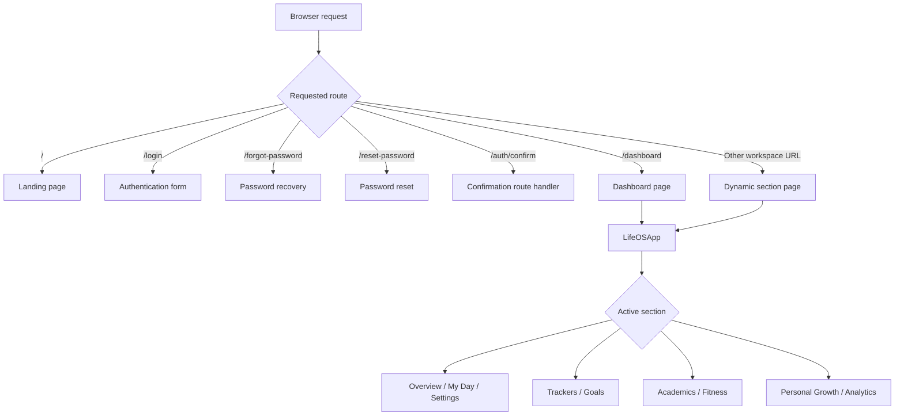

# 7. System architecture

LifeOS uses a browser-based frontend with Supabase as its managed backend platform. It can be understood in four parts:

1. **Presentation layer:** landing page, authentication forms, dashboard, workspaces, controls, dialogs and charts. Built with React components and CSS.
2. **Application logic:** React state, form validation, calculations, database payload preparation, Supabase calls, response processing and UI updates. Most of this currently lives in client components.
3. **Supabase service layer:** authentication, sessions and Data API. Fitness also calls a PostgreSQL RPC through the Supabase client.
4. **Database layer:** PostgreSQL records, constraints, grants and RLS policies.

## 7.1 High-level architecture

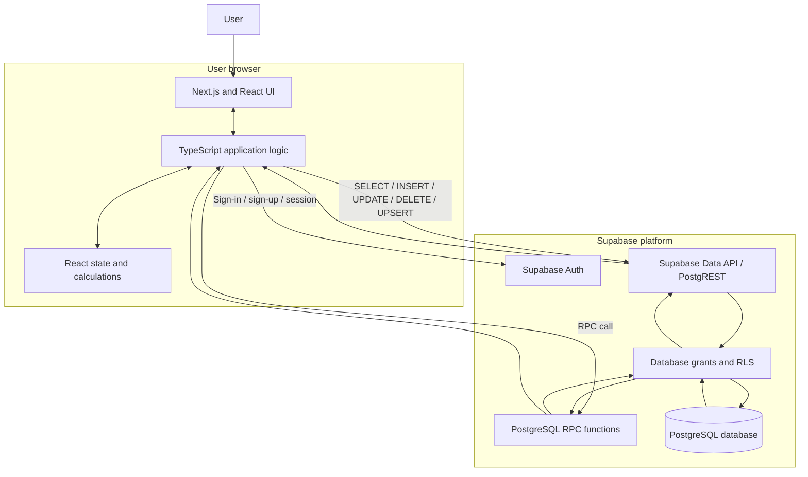

The browser does not connect directly to PostgreSQL using a database password. It uses the Supabase client and API. PostgreSQL remains behind the Supabase API and database authorization layer.

## 7.2 Component architecture

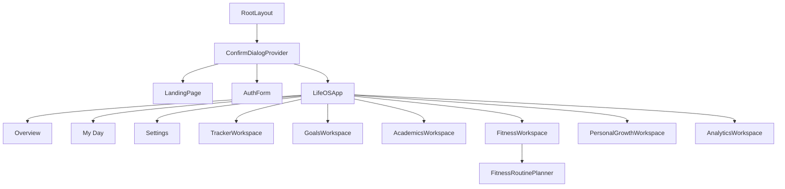

## 7.3 Opening a workspace

1. The browser requests a route.
2. The Next.js Proxy checks the session/claims for protected routes.
3. The route renders the main application shell.
4. `LifeOSApp` reads the current pathname.
5. The active section is selected.
6. A separate feature workspace is dynamically loaded when needed.
7. The feature checks the current user/session where required.
8. It requests its data from Supabase.
9. Supabase evaluates the request using the authenticated identity, grants and RLS.
10. Returned rows are mapped into frontend objects and displayed.

# 8. Supabase connection and API communication

The helper files are `src/lib/supabase/client.ts`, `src/lib/supabase/server.ts`, `src/lib/supabase/proxy.ts` and `src/proxy.ts`.

## 8.1 Browser client

`src/lib/supabase/client.ts` creates the browser client:

```ts
import { createBrowserClient } from "@supabase/ssr";

export function createClient() {
  return createBrowserClient(
    process.env.NEXT_PUBLIC_SUPABASE_URL!,
    process.env.NEXT_PUBLIC_SUPABASE_PUBLISHABLE_KEY!,
  );
}
```

- `createBrowserClient` creates a Supabase client for browser-side code.
- `NEXT_PUBLIC_SUPABASE_URL` identifies the Supabase project endpoint.
- `NEXT_PUBLIC_SUPABASE_PUBLISHABLE_KEY` is the public/publishable key used by the browser client.
- `!` is TypeScript's non-null assertion. It tells TypeScript to treat the value as present; it does not check at runtime that the variable is configured.

Feature components call `createClient()` when they need to read or write data.

## 8.2 Server client

`src/lib/supabase/server.ts` uses `createServerClient` from `@supabase/ssr` and `cookies` from `next/headers`. It reads request cookies and passes cookie access methods to the Supabase SSR client. This connects server-side Supabase operations to the current session.

Its `setAll` method uses `try/catch` because not every Server Component context can write cookies. The request Proxy handles session refresh in the application request flow. The supplied source uses this server helper in `/auth/confirm`.

## 8.3 Proxy session helper

`src/lib/supabase/proxy.ts` creates a server client using incoming request cookies and calls:

```ts
const { data } = await supabase.auth.getClaims();
```

The claims are used to decide whether a protected request should continue or be redirected. Refreshed cookies are copied to the response. `src/proxy.ts` delegates to `updateSession`:

```ts
export async function proxy(request: NextRequest) {
  return await updateSession(request);
}
```

## 8.4 A normal database request

```ts
const supabase = createClient();

const { data, error } = await supabase
  .from("tasks")
  .select("id, title, priority, completed, task_date")
  .eq("user_id", user.id);
```

| Code | Meaning |
|---|---|
| `createClient()` | Creates the browser Supabase client |
| `.from("tasks")` | Selects the `tasks` table as the request target |
| `.select(...)` | Requests only the listed columns |
| `.eq("user_id", user.id)` | Adds a filter matching the current user's ID |
| `data` | Returned rows when successful |
| `error` | Error details when the request fails |

## 8.5 Supabase methods used

| Method | Meaning | Example |
|---|---|---|
| `.select()` | Read records | Load tasks, goals or courses |
| `.insert()` | Create records | Add a task |
| `.update()` | Update matching records | Edit a goal/profile |
| `.delete()` | Delete matching records | Delete a task or tracker |
| `.upsert()` | Insert or update based on conflict target | Save a dated habit check-in |
| `.eq()` | Equality filter | Filter by user or record ID |
| `.gte()` | Greater-than-or-equal filter | Start of a date range |
| `.lte()` | Less-than-or-equal filter | End of a date range |
| `.order()` | Sort returned rows | Sort upcoming tasks by date |
| `.single()` | Expect exactly one row | Return a newly inserted course |
| `.maybeSingle()` | Expect zero or one row | Read optional profile information |
| `.rpc()` | Call a PostgreSQL function | Synchronize a Fitness workout |

## 8.6 Does LifeOS have its own REST API?

The supplied source does not contain a general custom REST API backend. Most feature components use the Supabase JavaScript client, which communicates with Supabase's Data API (PostgREST).

The custom Next.js route handler found in the source is `/auth/confirm`; it handles authentication callback/session exchange. It is not a general CRUD API. The Fitness synchronization operation is a PostgreSQL RPC called with `.rpc()`, not a Next.js `/api` route.

## 8.7 Request lifecycle diagram

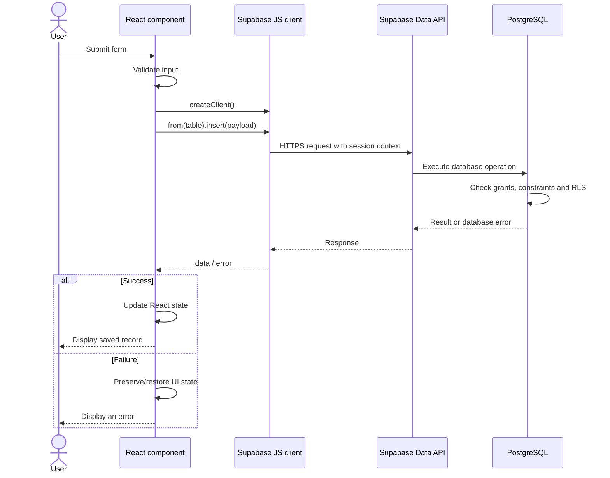

---

# 9. Authentication

Authentication answers: **“Who is this user?”** LifeOS uses Supabase Authentication. The application does not implement its own password database.

Important files:

- `src/app/login/auth-form.tsx`
- `src/app/forgot-password/page.tsx`
- `src/app/reset-password/page.tsx`
- `src/app/auth/confirm/route.ts`
- `src/lib/supabase/client.ts`
- `src/lib/supabase/server.ts`
- `src/lib/supabase/proxy.ts`
- `src/proxy.ts`

## 9.1 Sign-up flow

The login form has two modes:

```ts
type AuthMode = "signin" | "signup";
```

The sign-up form collects full name, email, password and password confirmation. The client validates that the name has at least two characters, the password has at least eight characters, and the two password fields match.

It then calls:

```ts
supabase.auth.signUp({
  email: email.trim(),
  password,
  options: {
    emailRedirectTo: ".../auth/confirm?next=...",
    data: { display_name: fullName.trim() },
  },
});
```

`data.display_name` is user metadata sent with the Auth request. It is not the same as directly inserting a row into the `profiles` table from this form.

If a session is immediately returned, the UI redirects to the selected safe destination. If no session is returned, the UI displays a confirmation message and offers a resend-confirmation flow.

## 9.2 Resend confirmation email

The resend flow uses:

```ts
supabase.auth.resend({
  type: "signup",
  email: targetEmail,
  options: { emailRedirectTo: ".../auth/confirm?next=..." },
});
```

The form validates the email, prevents repeated clicks during a request and uses a 60-second client-side resend cooldown. It displays generic feedback and handles rate-limit-related errors. The 60-second countdown is frontend behavior; it is not the same as Supabase's server-side email rate limits.

## 9.3 Login

Login calls:

```ts
supabase.auth.signInWithPassword({
  email: email.trim(),
  password,
});
```

After success, the app uses `router.replace(nextPath)` and `router.refresh()`.

The `next` parameter is passed through a safe-path helper. Unsafe values such as missing paths, paths that do not begin with `/`, paths beginning with `//`, paths with backslashes, `/login` and `/login?...` are rejected. The fallback is `/dashboard`. This helps prevent the redirect parameter from being used as an arbitrary external redirect.

## 9.4 Forgot password

`src/app/forgot-password/page.tsx` uses:

```ts
supabase.auth.resetPasswordForEmail(email.trim(), {
  redirectTo: callbackUrl.toString(),
});
```

The callback asks `/auth/confirm` to continue to `/reset-password` after the code is exchanged.

The UI uses a generic message along the lines of “If an account exists for this email, a reset link has been sent.” This avoids directly confirming whether an email address is registered.

## 9.5 Confirmation route

`src/app/auth/confirm/route.ts` is a server GET route handler. It:

1. Reads the `code` query parameter.
2. Reads the requested `next` path.
3. Validates the path through the safe redirect helper.
4. Creates the server-side Supabase client.
5. Calls `exchangeCodeForSession(code)`.
6. Redirects to the safe destination if the exchange succeeds.
7. Redirects to login with an error indicator if the exchange fails.

This is where the one-time confirmation code is exchanged for a session.

## 9.6 Reset password

The reset page checks the current user/session using `supabase.auth.getUser()`. The new password form is enabled only when the reset session is valid.

It checks that the password has at least eight characters and that both password fields match, then calls:

```ts
supabase.auth.updateUser({ password });
```

After a successful update, it signs out the current local session with:

```ts
supabase.auth.signOut({ scope: "local" });
```

The user is then asked to sign in again with the new password.

## 9.7 Authentication sequence diagram

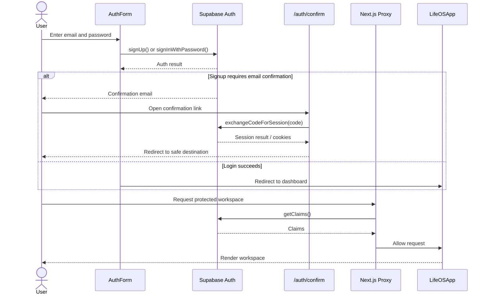

## 9.8 Local Auth configuration note

The supplied `supabase/config.toml` is a local Supabase CLI configuration file. It enables email authentication and local sign-up, sets local email confirmation to `false`, and has a local minimum password length of 6. The React sign-up/reset forms enforce an eight-character minimum.

These settings are not identical. Also, the local config does not prove the current settings of the hosted Supabase project. Hosted Auth settings must be checked separately before making a claim about production email confirmation or password policy.

# 10. Authorization and database security

Authorization answers: **“What is this authenticated user allowed to access or change?”** A person can be signed in but still must not be allowed to read another user's tasks, edit another user's profile or delete someone else's workout.

## 10.1 `user_id` filters in application queries

Most feature queries include a filter such as:

```ts
.eq("user_id", user.id)
```

This narrows the request to the current user's records. It is good query design, but it is not the final security boundary because a person can modify a browser request. The database must independently enforce ownership.

## 10.2 Row Level Security

RLS means Row Level Security. PostgreSQL can use RLS policies to decide which rows a role may see or change.

A typical owner-only policy is:

```sql
USING (auth.uid() = user_id)
WITH CHECK (auth.uid() = user_id)
```

- `auth.uid()` returns the user ID represented by the authenticated request.
- `USING` determines which existing rows a command may target.
- `WITH CHECK` validates the row being inserted or the new row produced by an update.

For example, a correctly configured owner-only SELECT policy should prevent Account A from reading Account B's task row.

## 10.3 Grants and roles

PostgreSQL/Supabase uses roles such as:

- `anon`: API role used for unauthenticated requests.
- `authenticated`: API role used for authenticated requests.
- `PUBLIC`: privileges granted to all roles unless revoked.

A grant controls whether a role may attempt an operation on a table, column or function. RLS then controls which rows that operation may affect.

| Control | Question it answers |
|---|---|
| Table/column grant | Is this role allowed to attempt this operation on this object/column? |
| RLS policy | Which rows may the role access or modify? |
| Input validation | Is the submitted value valid for the application? |
| Database constraint | Is the value allowed by the database schema? |
| Trigger/function | Should a value be calculated or controlled by database logic? |

A secure setup needs the appropriate combination of these controls.

## 10.4 Authorization flow

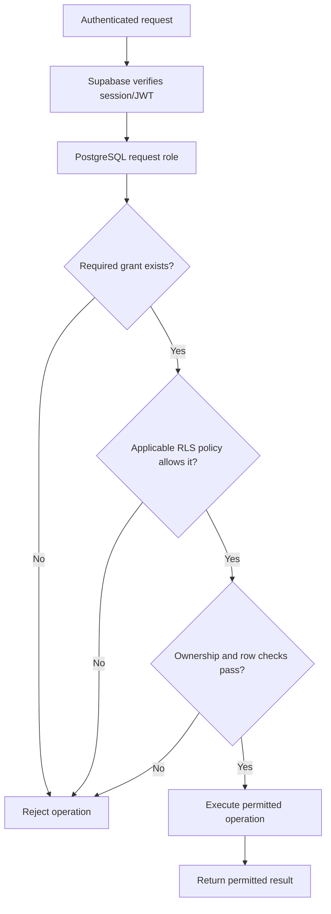

## 10.5 Why both frontend filters and RLS?

The frontend filter asks for the expected user's records and avoids unnecessary retrieval. RLS independently enforces the database rule. If someone changes the request outside the normal UI, the database must still reject unauthorized access.

## 10.6 What the supplied source proves

The Fitness routine migration explicitly enables RLS and creates owner policies for its four new tables.

The task migration changes table/column privileges and replaces a timestamp trigger function. Earlier security-audit notes record an observed owner policy for `public.tasks` named `owner_manage_tasks` with `auth.uid() = user_id` in both `USING` and `WITH CHECK`.

The ZIP does not include the original base migrations for all application tables. Therefore, the exact current RLS policies for every table need to be checked in the actual database. An earlier observation is historical evidence, not automatic proof that the hosted database still has exactly the same configuration today.

# 11. Database design overview

LifeOS uses PostgreSQL through Supabase. Main application records are saved in the database rather than being stored only in browser memory.

## 11.1 User ownership

Most application records have a `user_id` column. For example:

```text
tasks
├── id
├── user_id
├── title
├── priority
├── completed
└── task_date
```

The `user_id` associates the record with the account that owns it. The frontend gets the current user identity from Supabase Auth and uses it in reads/writes. RLS should independently enforce ownership in the database.

## 11.2 Why records are split into tables

Consider a goal with several milestones. Storing the whole milestone list inside one changing text field would make editing and querying individual milestones difficult. LifeOS stores the goal separately from milestone records and associates each milestone with `goal_id`.

The same pattern is used for:

- Courses and assessments.
- Learning paths and milestones.
- Learning paths and practice sessions.
- Workout days and exercises.
- Weekly routines and routine exercises.

## 11.3 Application-level relationship map

The following diagram shows how the source code groups related records. It is **not** a substitute for a complete PostgreSQL schema dump. Except where the included migrations define a foreign key, relationships here are application-level associations inferred from queries and data models.

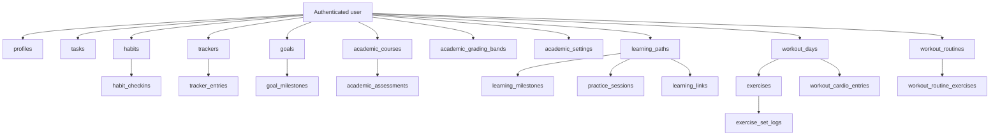

# 12. Tables referenced by the application

This section lists tables and columns observed in frontend queries/payloads and the four included SQL migrations. **It is not a complete DDL listing.** Defaults, every data type, all primary/foreign keys, indexes, triggers and policies for older tables require the original database schema export.

## 12.1 Account and Overview tables

### `profiles`

Used by Settings and initial account loading. Columns observed: `id`, `display_name`, `date_of_birth`.

The app reads the row using `id = user.id`. It updates `display_name` and `date_of_birth`. Age is calculated from date of birth in frontend code rather than storing a second age field that would become outdated.

`20261016180000_add_profile_date_of_birth.sql` adds `date_of_birth DATE` and grants authenticated users column-level UPDATE permission for that column. It assumes the profile table and ownership RLS policies already exist.

### `tasks`

Used by My Day and Analytics. Columns observed: `id`, `user_id`, `title`, `priority`, `completed`, `task_date`, `created_at` and `completed_at` (the latter was seen in the security investigation and timestamp function).

The frontend priority union is:

```ts
type Priority = "Low" | "Medium" | "High";
```

The database uses `task_date`; the frontend `Task` object maps it into a shorter property called `date`.

### `habits`

Used by the Overview habit section. Columns observed: `id`, `user_id`, `title`, `meta`, `icon_key`, `sort_order`, `is_active`.

The Overview loads active habits with `is_active = true`. Stopping a habit updates `is_active` to false; it does not delete old check-in history.

### `habit_checkins`

Stores whether a habit was completed on a date. Columns observed: `user_id`, `habit_id`, `checkin_date`, `completed`.

The application upserts using conflict target `user_id,habit_id,checkin_date`, so the same habit/date is treated as one logical check-in record.

## 12.2 Tracker tables

### `trackers`

Columns observed: `id`, `user_id`, `name`, `tracker_type`, `category`, `unit`, `target`, `created_at`.

Tracker types in the frontend:

```ts
type TrackerType =
  | "boolean"
  | "count"
  | "duration"
  | "numeric"
  | "rating";
```

### `tracker_entries`

Columns observed: `user_id`, `tracker_id`, `entry_date`, `value`. The workspace upserts with conflict target `user_id,tracker_id,entry_date`.

## 12.3 Goals tables

### `goals`

Columns observed: `id`, `user_id`, `title`, `description`, `category`, `target_date`, `created_at`.

### `goal_milestones`

Columns observed: `id`, `user_id`, `goal_id`, `title`, `completed`, `sort_order`.

The app groups milestone rows under goals using `goal_id`. Progress is completed milestones divided by total milestones. A goal with no milestones is shown as 0% milestone progress.

## 12.4 Personal Growth tables

### `learning_paths`

Columns observed: `id`, `user_id`, `title`, `category`, `description`, `target_date`, `created_at`.

### `learning_milestones`

Columns observed: `id`, `user_id`, `learning_path_id`, `title`, `completed`, `sort_order`.

### `practice_sessions`

Columns observed: `id`, `user_id`, `learning_path_id`, `practice_date`, `minutes`, `note`, `created_at`.

A practice session is associated with a learning path. The Overview reads this table and sums `minutes` where `user_id` and `practice_date` match the current user and today.

### `learning_links`

Columns observed: `id`, `user_id`, `learning_path_id`, `title`, `link_kind`, `url`, `created_at`.

The frontend supports `Project`, `Resource` and `Certificate` link types. `getHttpUrl` accepts valid `http://` or `https://` URLs, or an empty URL, and rejects other protocols.

## 12.5 Academic tables

### `academic_courses`

Columns observed: `id`, `user_id`, `name`, `code`, `credits`, `created_at`.

### `academic_assessments`

Columns observed: `id`, `user_id`, `course_id`, `title`, `assessment_type`, `due_date`, `completed`, `obtained_marks`, `total_marks`, `result_status`, `created_at`.

Assessment types in the source include Assignment, Quiz, Viva, Presentation, Lab-Report, Attendance, Mid-term Exam, Final Exam, Project, Lab Final and Other. `result_status` is `Pending` or `Received`. Only received results are included in the relevant marks calculations.

### `academic_grading_bands`

Columns observed: `id`, `user_id`, `min_mark`, `max_mark`, `grade_point`, `grade`, `sort_order`.

These rows define the user's grading scale. The app validates that at least one band exists, marks are 0–100, minimum is not greater than maximum, grade points are 0–5 and ranges do not overlap.

### `academic_settings`

Columns observed: `user_id`, `previous_cgpa`, `completed_credits`. These user-entered previous academic values are used for projected CGPA calculations.

## 12.6 Fitness tables

### `workout_days`

Columns observed: `user_id`, `workout_date`, `title`. The planner treats `(user_id, workout_date)` as the upsert conflict target.

### `exercises`

Columns observed: `id`, `user_id`, `workout_date`, `name`, `sets`, `reps`, `weight_kg`, `weight_spec`, `completed`, `sort_order`.

The numeric `weight_kg` field is retained for compatibility; `weight_spec` supports a single value, ranges and lists.

### `workout_routines`

Created by the included Fitness routine migration. Columns: `id`, `user_id`, `name`, `weekday`, `is_active`, `sort_order`, `created_at`, `updated_at`. Composite primary key: `(user_id, id)`. Unique constraint: `(user_id, weekday, name)`.

### `workout_routine_exercises`

Created by the included migration. Columns: `id`, `user_id`, `routine_id`, `name`, `item_type`, `target_sets`, `target_reps`, `target_weight_kg`, `target_weight_spec` (added by the next migration), `target_duration_minutes`, `target_distance_km`, `sort_order`, `created_at`, `updated_at`.

`item_type` is constrained to `strength` or `cardio`. The migration applies checks for valid strength/cardio target combinations.

### `workout_cardio_entries`

Created by the included migration. Columns: `id`, `user_id`, `workout_date`, `name`, `planned_duration_minutes`, `actual_duration_minutes`, `planned_distance_km`, `actual_distance_km`, `completed`, `sort_order`, `created_at`, `updated_at`.

The migration creates a composite foreign key to `workout_days(user_id, workout_date)`. The source creates this table, but the current frontend does not make a direct `.from("workout_cardio_entries")` request.

### `exercise_set_logs`

Created by the included migration. Columns: `user_id`, `exercise_id`, `set_number`, `actual_reps`, `actual_weight_kg`, `completed`, `updated_at`.

The migration applies checks for set number, reps and weight and creates a composite foreign key to `exercises(user_id, id)`. The frontend does not currently make direct requests to this table. The routine synchronization function checks whether it exists and removes set logs beyond a reduced set count.

## 12.7 Analytics data sources

Analytics is a read-oriented workspace. It loads data from `tasks`, `workout_days`, `exercises`, `learning_paths`, `learning_milestones`, `practice_sessions`, `learning_links`, `academic_courses`, `academic_assessments`, `academic_grading_bands`, `academic_settings`, `goals`, `goal_milestones` and `trackers`.

It builds events and calculates completion rates, practice duration, workout activity, learning progress, academic summaries, goal statistics and tracker counts. The supplied Analytics code does not create a separate analytics event table and does not load `habit_checkins` as one of its main analytics sources.

## 12.8 Explicit relationships in the Fitness migration

The following relationships are explicitly present in the included Fitness SQL migration. This diagram is not a claim about the missing original base schema.

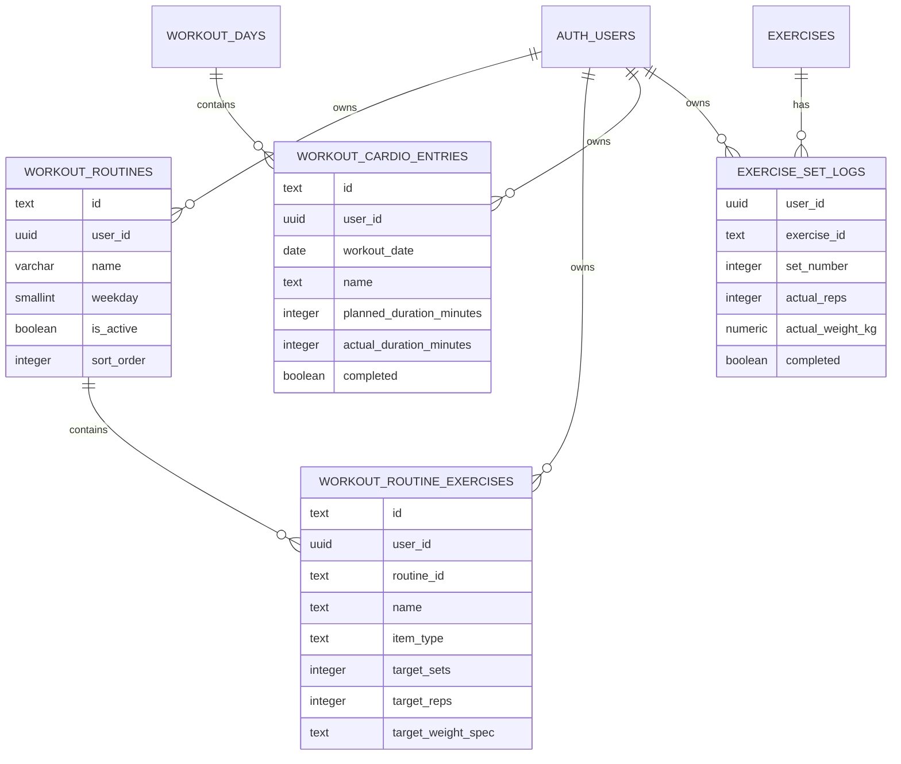

`AUTH_USERS` represents Supabase Auth users conceptually; the migration explicitly references `auth.users(id)`. `WORKOUT_DAYS` and `EXERCISES` are referenced by the migration, but their original table-creation DDL is not included in this ZIP.

---

# 13. SQL migrations explained

A migration is a versioned SQL change to the database. It lets the project record schema and permission changes over time.

The supplied repository contains four migrations:

```text
supabase/migrations/
├── 20261016180000_add_profile_date_of_birth.sql
├── 20261027190000_add_fitness_routine_planner.sql
├── 20261027200000_add_fitness_weight_specs_and_sync.sql
└── 20261102170612_harden_tasks_property_integrity.sql
```

## 13.1 `20261016180000_add_profile_date_of_birth.sql`

**Purpose:** add an optional date of birth to the existing `profiles` table.

```sql
ALTER TABLE public.profiles
ADD COLUMN IF NOT EXISTS date_of_birth DATE;
```

`IF NOT EXISTS` means the column is added only if it is not already present.

The migration grants column-level update permission:

```sql
GRANT UPDATE (date_of_birth)
ON TABLE public.profiles
TO authenticated;
```

The SQL comment says the existing profile RLS policies must still restrict the user to their own profile. This migration does not create the profile table or its original RLS policies.

It also adds a database column comment explaining that date of birth is optional and that age should be calculated when needed rather than stored separately.

## 13.2 `20261027190000_add_fitness_routine_planner.sql`

**Purpose:** add reusable weekly routines and related supporting Fitness tables.

It creates:

1. `workout_routines`
2. `workout_routine_exercises`
3. `workout_cardio_entries`
4. `exercise_set_logs`

The migration is wrapped in:

```sql
BEGIN;
...
COMMIT;
```

A transaction groups the changes. If an error occurs before commit, PostgreSQL can roll the transaction back instead of leaving only part of the change applied.

### `workout_routines`

Important details:

- `id` defaults to `gen_random_uuid()::text`.
- `user_id` references `auth.users(id)` and cascades on user deletion.
- `name` must not be blank and has a maximum column length of 70 characters.
- `weekday` must be between 0 and 6.
- `is_active` defaults to true.
- `sort_order` defaults to 0.
- `created_at` and `updated_at` default to `now()`.
- Primary key is `(user_id, id)`.
- Unique constraint is `(user_id, weekday, name)`.

### `workout_routine_exercises`

Each row belongs to a routine through the composite foreign key `(user_id, routine_id)`.

The table supports two item types: `strength` and `cardio`.

Strength rows require sets and reps in defined limits and require duration/distance fields to be null. Cardio rows require a duration and keep strength-only fields null. Weight and distance values are constrained to positive values at or below 1000.

### `workout_cardio_entries`

This table stores planned and actual cardio duration/distance for a dated workout. It references `workout_days(user_id, workout_date)` with `ON DELETE CASCADE`, so deleting the parent workout day deletes the related cardio rows.

At least one of planned duration or actual duration must be present.

### `exercise_set_logs`

This table stores actual set-level results for an exercise. Its primary key is `(user_id, exercise_id, set_number)`. It references `exercises(user_id, id)` and cascades when the parent exercise is deleted.

A completed set must have `actual_reps`.

### Indexes

The migration creates indexes to support common lookups and ordering:

- `workout_routines_user_weekday_idx` on `(user_id, weekday, sort_order)`.
- `workout_routine_exercises_order_idx` on `(user_id, routine_id, sort_order)`.
- `workout_cardio_entries_date_idx` on `(user_id, workout_date, sort_order)`.

An index can help PostgreSQL find and order relevant rows more efficiently. It does not replace a primary key, foreign key or RLS policy.

### RLS and grants

The migration loops over the four new tables. For each one, it:

1. Enables RLS.
2. Revokes all table privileges from `PUBLIC`, `anon` and `authenticated`.
3. Grants `SELECT`, `INSERT`, `UPDATE` and `DELETE` to `authenticated`.
4. Creates an owner-only policy if the named policy does not already exist.

The policy uses:

```sql
USING ((SELECT auth.uid()) = user_id)
WITH CHECK ((SELECT auth.uid()) = user_id)
```

This limits rows to the authenticated owner.

## 13.3 `20261027200000_add_fitness_weight_specs_and_sync.sql`

**Purpose:** support flexible weight specifications and synchronize a weekly routine into a dated workout.

### A. Add weight specification columns

```sql
ALTER TABLE public.workout_routine_exercises
ADD COLUMN IF NOT EXISTS target_weight_spec text;

ALTER TABLE public.exercises
ADD COLUMN IF NOT EXISTS weight_spec text;
```

The older numeric columns are retained for compatibility.

### B. Weight validation function

The migration creates:

```sql
public.is_valid_fitness_weight_spec(p_spec text)
```

It accepts formats such as:

```text
30
40-55
34,50
30,40-55,50
```

The SQL function trims whitespace, requires a compact specification between 1 and 64 characters when not NULL, allows up to ten comma-separated segments, allows a single value or ascending range in each segment, allows up to six decimal places, and requires each number to be greater than 0 and at most 1000 kg. It returns false for invalid text or conversion errors.

It is declared `IMMUTABLE`, meaning it is intended to return the same result for the same input and not depend on changing table data.

The migration revokes function execution from `PUBLIC` and `anon` and grants it to `authenticated`. It adds CHECK constraints to `workout_routine_exercises.target_weight_spec` and `exercises.weight_spec` using this validator.

### C. Routine synchronization RPC

The migration creates:

```sql
public.sync_fitness_workout_from_routine(
  p_routine_id text,
  p_workout_date date,
  p_title text,
  p_exercises jsonb
)
RETURNS jsonb
```

Its main responsibilities are:

1. Read the caller's identity using `auth.uid()`.
2. Reject a missing authenticated user.
3. Validate the workout date.
4. Validate the workout title (1–70 characters after trimming).
5. Require `p_exercises` to be a JSON array.
6. Require 1–30 exercises.
7. Confirm that the selected routine belongs to the current user and is active.
8. Reject a routine that contains cardio items in this synchronization workflow.
9. Validate every exercise before changing the dated workout.
10. Validate exercise names (1–80 characters), sets (1–30), reps (1–200) and weight specification.
11. Upsert the dated workout row using `(user_id, workout_date)`.
12. Update matching existing exercises or insert new ones.
13. Preserve a legacy numeric weight for a single scalar value.
14. Store ranges/lists in `weight_spec` and keep the numeric field NULL for those values.
15. Remove exercises no longer part of the submitted workout.
16. If the set-log table exists, remove logs for sets beyond a reduced set count.
17. Return a JSON representation of the saved workout.

The function is declared:

```sql
SECURITY INVOKER
SET search_path = public, pg_temp
```

`SECURITY INVOKER` means it runs with the caller's privileges, so the caller's normal table permissions and RLS still matter. The restricted `search_path` helps make object resolution predictable.

The migration revokes execute permission from `PUBLIC` and `anon` and grants it to `authenticated`.

### D. Transaction behavior

The synchronization is performed inside one PostgreSQL function call. If the function raises an exception, the call's database changes are rolled back rather than leaving a partially synchronized workout.

### E. Cardio limitation

The routine schema supports strength and cardio item types. The current `sync_fitness_workout_from_routine` function deliberately rejects a routine containing cardio items. Therefore, cardio routine targets can be represented in the schema, but the current routine-to-dated-workout synchronization flow supports strength exercises only. Cardio snapshot support is not complete in this workflow.

## 13.4 `20261102170612_harden_tasks_property_integrity.sql`

**Purpose:** restrict authenticated task creation/update to expected columns and replace the task completion timestamp function.

### A. Revoke broad privileges

```sql
REVOKE INSERT, UPDATE
ON TABLE public.tasks
FROM authenticated;
```

Then the migration grants INSERT only on `user_id`, `title`, `priority` and `task_date`. It grants UPDATE only on `title`, `priority`, `task_date` and `completed`.

The goal is to let the client submit normal user-editable task data without freely setting system-managed properties such as an ID or completion timestamp. The migration comments say existing SELECT, DELETE and RLS behavior should be preserved.

### B. Completion timestamp function

The migration replaces:

```sql
public.sync_task_completion_timestamp()
```

Its behavior:

- On INSERT, if the new task is completed, set `completed_at = now()`; otherwise set it to NULL.
- On UPDATE, if `completed` changed, set or clear `completed_at` based on the new state.
- If completion state did not change, preserve the old `completed_at` value.

This prevents a normal client update from choosing an arbitrary completion timestamp when the trigger is attached and running.

**Important:** this migration replaces the trigger function definition. It does not contain a `CREATE TRIGGER` statement. The trigger attachment must already exist for the function to execute automatically.

### C. Repository vs production

The migration file is present in the supplied repository snapshot. This alone does not prove it has been applied to the hosted Supabase database. The Day 5 remediation was also recreated and tested in a separate local Supabase lab. Local validation must not be described as proof that the production database has been changed.

## 13.5 Why the migrations do not reproduce the whole database

The included migrations do not create every table used by the app. Original DDL for these tables is not present in the supplied archive:

- `profiles`
- `tasks`
- `habits`
- `habit_checkins`
- `trackers`
- `tracker_entries`
- `goals`
- `goal_milestones`
- `learning_paths`
- `learning_milestones`
- `practice_sessions`
- `learning_links`
- `academic_courses`
- `academic_assessments`
- `academic_grading_bands`
- `academic_settings`
- `workout_days`
- `exercises`

Some existed before the included migrations. Their full original column definitions, constraints, indexes, defaults, policies and triggers cannot be reconstructed with certainty from this ZIP alone.

Also, `supabase/config.toml` contains:

```toml
[db.seed]
enabled = true
sql_paths = ["./seed.sql"]
```

But `supabase/seed.sql` is not present in the ZIP. A full local database reset is therefore not guaranteed to recreate the entire LifeOS schema from this export alone.

---

# 14. Feature implementation walkthrough

This section explains what each workspace does and how its source code works.

## 14.1 Overview dashboard

**Main file:** `src/app/lifeos-app.tsx`

The Overview combines information from the profile, tasks, habits, habit check-ins and practice sessions.

### Main data loader

The main loader is `loadCloudData()`.

At a high level it:

1. Sets the loading state.
2. Clears the previous load warning.
3. Reads the saved theme.
4. Calculates today's date and the date six days earlier.
5. Creates the browser Supabase client.
6. Reads the current session and user.
7. Loads profile information.
8. Loads tasks.
9. Loads active habits and today's check-ins.
10. Loads seven-day habit activity.
11. Loads history used for the streak calculation.
12. Loads today's practice time.

Independent data groups are started together using `Promise.all`. The helper `runSafely` isolates each group so one failed group does not necessarily prevent every other group from loading.

### Request timeouts

The main app defines:

```ts
const CLOUD_REQUEST_TIMEOUT_MS = 12_000;
```

It has `withRequestTimeout` and `withTimedQuery` helpers. The first races a promise against a timeout; the second uses `AbortController` and passes a signal to a compatible query. This makes the main loader more resilient to a request that takes too long. It does not mean every feature workspace has identical timeout behavior.

### Starter habits

If the habits query succeeds and returns zero active habits, the app upserts starter habits such as morning workout, reading, programming study and drinking water. The upsert uses `ignoreDuplicates: true` and then reloads active habits.

The important distinction is that a successful empty result can trigger starter seeding. A failed query is not treated as proof that the user has no habits.

### Weekly activity

The app requests completed check-ins between today minus six days and today. It counts completed check-in rows, groups them by date, calculates each day's count, finds the maximum daily count and converts each day's count into a percentage relative to that maximum.

`weeklyCheckInCount` is the number of completed check-in rows in that seven-calendar-day period. It is not the number of unique active days.

### Habit streak

The helper `calculateCurrentStreak(completedDateKeys, currentDateKey)` uses a `Set` of completed dates. If today has no completed habit, it begins checking from yesterday. It then moves backwards one calendar day at a time until it finds a day with no completed check-in.

### Today's Practice Time

The Overview reads the `minutes` column from `practice_sessions`, filtered by current `user_id` and today's `practice_date`, then sums the returned values. This is the daily total shown by the dashboard. Personal Growth and Analytics can show broader practice history/range totals.

## 14.2 My Day — task management

**Main file:** `src/app/lifeos-app.tsx`

The frontend task model is:

```ts
type Task = {
  id: string;
  title: string;
  priority: Priority;
  completed: boolean;
  date: string;
};
```

The database stores the date as `task_date`; the UI maps it into `date`.

### Creating a task

The handler is `addTask(event)`. It:

1. Prevents the form's default browser submit behavior.
2. Trims the task title.
3. Confirms that a current user ID is available.
4. Uses today's date when no date is selected.
5. Rejects a date earlier than today.
6. Inserts the allowed task properties into `tasks`.
7. Requests the saved row back with `.select(...)`.
8. Maps the returned database row into a `Task` object.
9. Updates React state.
10. Resets the form and chooses Today or Upcoming according to the date.

The current create payload is:

```ts
{
  user_id: cloudUserId,
  title,
  priority: taskPriority,
  task_date: taskDate,
}
```

It does not send a client-generated ID or an explicit `completed: false`; those values are expected to come from database defaults.

### Completing or uncompleting a task

`toggleTask` updates the `completed` column. The query filters by both current `user_id` and task `id`. Local React state is updated after the database operation succeeds.

### Editing a task

The edit flow uses `startTaskEdit`, `cancelTaskEdit` and `saveTaskEdit`. It copies the selected task into edit state, validates the title and date, updates `title`, `priority` and `task_date`, requests the saved row and replaces the matching task in local state. It then selects Today or Upcoming according to the saved date.

### Deleting a task

The handler asks the global confirmation provider to display a confirmation dialog. If the user confirms, it sends a DELETE filtered by `user_id` and task ID. The task is removed from local state only after the database request succeeds.

### Task scopes and filters

Scopes are Today and Upcoming. Filters are All, To do and Completed. Upcoming tasks have a date after today and are sorted by date. The application compares `YYYY-MM-DD` date strings, which sort chronologically when they use that format.

### Task creation sequence

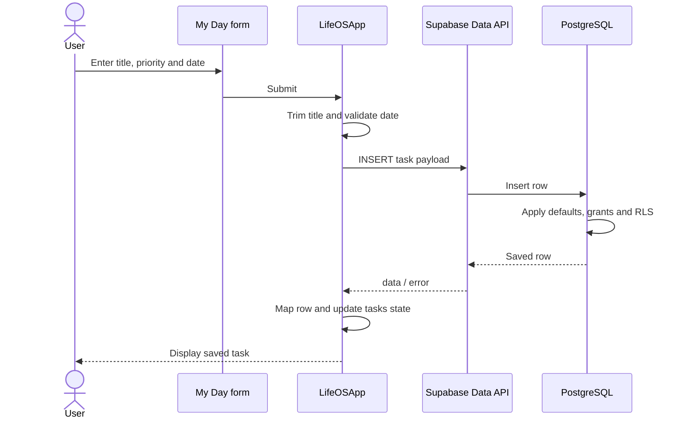

## 14.3 Habit check-ins

**Main file:** `src/app/lifeos-app.tsx`

Habit definition and completion history are stored separately: `habits` stores the habit itself, and `habit_checkins` stores whether it was completed on a date.

`toggleHabit(id)` finds the selected habit in local state, calculates the next completion value, upserts a row into `habit_checkins` using `user_id,habit_id,checkin_date` as the conflict target, and updates the UI after success.

`addHabit` inserts a new habit with a generated UUID, current user ID, title, default metadata, icon key, sort order and `is_active: true`.

`saveHabitEdit` updates the title and metadata and uses the returned icon key when rendering.

`stopTrackingHabit` is an archive-style action. It asks for confirmation, sets `is_active` to false, removes the habit from the active list and reloads historical data. Old check-ins are kept rather than deleted.

## 14.4 Trackers

**File:** `src/features/trackers/tracker-workspace.tsx`

Trackers let the user create custom values to record over time. Types are:

```ts
type TrackerType =
  | "boolean"
  | "count"
  | "duration"
  | "numeric"
  | "rating";
```

The workspace checks the current user, loads tracker rows and dated entries, groups entries under the matching tracker and converts numeric values into JavaScript numbers where needed.

`saveCheckIn(trackerId, value, selectedDate)` normalizes values by type: Boolean becomes 0 or 1; Rating is rounded and limited to 1–5; other numeric types cannot be negative; future-dated entries are prevented. It upserts `tracker_entries` using `user_id,tracker_id,entry_date` as the conflict target.

Deleting a tracker requires confirmation. The frontend deletes the tracker row filtered by user and tracker ID. Related-entry cleanup depends on the actual database foreign-key/delete configuration, which is not fully defined in this ZIP.

## 14.5 Goals

**File:** `src/features/goals/goals-workspace.tsx`

A goal has a title, description, category, target date and milestone list. The app supports creating, editing and deleting goals and adding, editing, completing, deleting and reordering milestones.

### Goal progress

The `getProgress` helper calculates:

```text
completed milestone count
------------------------- × 100
total milestone count
```

A goal with no milestones returns 0% milestone progress. This is a milestone completion metric, not an AI prediction or time-based probability of success.

### Milestone ordering

`sort_order` controls the displayed order. The reorder handler uses a temporary order value while swapping rows. It tracks which updates succeeded and attempts to roll back earlier changes if a later update fails.

These are separate API updates, not one PostgreSQL transaction. If the client disconnects between requests, a partial reorder may still require recovery.

## 14.6 Academics

**File:** `src/features/academics/academics-workspace.tsx`

The Academics workspace manages courses, assessments, marks and grade calculations.

Assessment types visible in the source include Assignment, Quiz, Viva, Presentation, Lab-Report, Attendance, Mid-term Exam, Final Exam, Project, Lab Final and Other. `result_status` is `Pending` or `Received`. Only assessments marked Received are included in the relevant marks calculations.

### Course percentage

For received assessments of a course:

```text
obtained = sum of obtained marks
possible = sum of total marks
percentage = obtained / possible × 100
```

The percentage is matched against the user's grading bands.

### Semester GPA

For each course with a calculated grade:

```text
weighted grade points = grade point × course credits
```

Then:

```text
Semester GPA = sum of weighted grade points / sum of graded course credits
```

Courses without a calculated grade are not included in the weighted calculation.

### Projected CGPA

The user enters previous CGPA and completed credits. The app combines the old weighted points with the current semester's weighted grade points:

```text
Projected CGPA =
(previous CGPA × previous credits + current weighted grade points)
--------------------------------------------------------------------
(previous credits + current graded credits)
```

This is a projection based on entered values and current course results.

### Grading bands

The file contains default grade-band values labelled A+, A, A-, B+, B, B-, C+, C, D and F. Users can edit the scale. The code checks that at least one band exists, marks are within 0–100, minimum is not greater than maximum, grade points are within 0–5 and ranges do not overlap.

A source comment describes the starter scale as a commonly published Southeast University undergraduate scale. Before using it for an official result, it should be checked against the official rules applicable to the user's own program and curriculum.

### Mark-save coordination

The Academics component uses refs named `assessmentMarksSaveQueue` and `assessmentMarksSaveVersions` to coordinate mark-saving requests for individual assessments. This helps avoid conflicting overlapping saves and allows the code to check whether a response belongs to the latest save version before displaying an error or restoring values.

## 14.7 Fitness

**File:** `src/features/fitness/fitness-workspace.tsx`

The Fitness workspace stores workouts by date. A workout day has a date, title and group of exercises. An exercise uses a name, sets, reps, optional numeric weight, optional flexible weight specification, completion state and sort order.

The workspace checks the current session, loads `workout_days` and `exercises`, groups exercises under the matching date and supports creating/editing/deleting workout days and exercises. The workout-day upsert uses conflict target `(user_id, workout_date)`.

## 14.8 Flexible Fitness weight specifications

**File:** `src/features/fitness/fitness-weight-spec.ts`

The parser accepts:

```text
30
40-55
34,50
30,40-55,50
```

The frontend parser removes whitespace, allows up to 64 characters and ten comma-separated segments, allows one or two decimal places, requires values greater than 0 and no more than 1000 kg, and requires a range to start with the smaller value.

For a single numeric value it can return a numeric value for the legacy `weight_kg` column. For a range or list, `numericValue` is null and the formatted value is stored in `weight_spec`. The SQL validator permits up to six decimal places, so it is more permissive than the frontend parser with respect to decimal precision.

## 14.9 Weekly Fitness routine planner

**File:** `src/features/fitness/fitness-routine-planner.tsx`

A routine is a reusable weekly template. A dated workout is the saved record for a particular date. Applying a routine copies its selected exercises into a dated workout. The interface is designed so that a later change to the routine does not rewrite an already saved dated workout.

The planner supports weekday selection, routine create/edit/delete, active/inactive state, routine exercise create/edit/reorder, custom workouts and applying a routine/custom workout to a date.

It calls:

```ts
syncClient.rpc("sync_fitness_workout_from_routine", {
  p_routine_id: routine.id,
  p_workout_date: selectedDate,
  p_title: workoutTitle,
  p_exercises: exercisesPayload,
});
```

The returned JSON is converted into a `WorkoutSnapshot` and passed back to the parent Fitness workspace.

The frontend tries to retain an existing exercise ID. It first checks a supplied ID and ensures it belongs to the selected workout and has not already been used. Otherwise it searches for an existing exercise with the same normalized name. If no match exists, the RPC receives a new exercise item.

**Cardio restriction:** the routine schema supports `strength` and `cardio` items, but the current synchronization function rejects routines containing cardio. The routine editor's data model supporting cardio does not mean cardio snapshot synchronization is finished.

## 14.10 Personal Growth

**File:** `src/features/personal-growth/personal-growth-workspace.tsx`

Personal Growth organizes learning and deliberate practice. A learning path stores a title, category, description and target date. Each path can have milestones, practice sessions and learning links.

A practice session stores date, duration in minutes, optional note and learning-path association. The source validates the duration to be between 1 and 1440 minutes. New sessions are saved to `practice_sessions` and added to the matching path in React state.

The same `practice_sessions` table is used by the Overview's daily Practice Time metric and Analytics' date-range practice totals.

Learning links can be Project, Resource or Certificate. The `getHttpUrl` helper accepts a valid HTTP or HTTPS URL, or an empty URL, and rejects other protocols such as `javascript:`.

## 14.11 Analytics

**File:** `src/features/analytics/analytics-workspace.tsx`

Analytics reads data from multiple LifeOS tables and calculates summaries in frontend code. The range options are 7 days, 30 days, 90 days and All time.

It loads tasks, workouts, exercises, learning paths, milestones, practice sessions, learning links, academic records, goals, goal milestones and trackers.

The source builds three major event categories: task events for completed tasks, Fitness events for completed exercises, and learning events for practice sessions. Events are sorted by date.

Task completion rate within the selected range is:

```text
completed tasks / total tasks × 100
```

When there are no tasks in the selected range, the result is null rather than a misleading zero-percent rate.

Learning time is the sum of practice-session minutes in the selected period. Fitness activity counts completed workout days based on whether a day has at least one completed exercise, and counts completed exercises. Analytics activity streak is the longest sequence of consecutive event dates within the selected range.

This is different from the Overview habit streak, which is based on `habit_checkins`. The supplied Analytics source does not create a separate analytics database or use a machine-learning prediction service; it calculates summaries from stored records.

## 14.12 Settings and theme

Settings UI is part of `src/app/lifeos-app.tsx`. The app reads the profile's `display_name` and `date_of_birth` and allows the user to update them. Email comes from Supabase Auth and is displayed as account information.

Age is calculated from date of birth in frontend code. It is not stored as a separate database value.

Theme state is stored in browser local storage under `lifeos-theme`. The root layout initializes the theme, and the main app's theme toggle updates it. This is one of the places where browser local storage is actively used. Main task, tracker, goal, academic and workout records are stored in Supabase, not only in local storage.

---

# 15. Important code concepts used in LifeOS

This section explains React, TypeScript and JavaScript patterns that appear throughout the source.

## 15.1 `"use client"`

```ts
"use client";
```

This marks a Client Component entry point in Next.js. It is used where a component needs browser-side behavior such as React state, event handlers, local storage, browser APIs or interactive Supabase requests.

## 15.2 `useState`

```ts
const [tasks, setTasks] = useState<Task[]>([]);
```

- `tasks` is the current state value.
- `setTasks` changes the state.
- `Task[]` means an array of Task objects.
- `[]` is the initial value.

When state changes, React renders the component again with the new value.

## 15.3 `useEffect`

```ts
useEffect(() => {
  void loadCloudData();
}, []);
```

`useEffect` is used for side effects after rendering. LifeOS uses it mainly for loading database data, checking a session, reading browser state and cleaning up asynchronous work. An empty dependency array means the effect is set up on the initial mount; other effects include dependencies so they can run when relevant values change.

## 15.4 `useMemo`

`useMemo` caches a calculated value until its dependencies change. It is useful for derived summaries, filtered collections, course calculations and Analytics events. It is a performance helper, not a database store.

## 15.5 `useRef`

`useRef` stores a mutable value without causing a component render when the ref changes. In LifeOS it is used for request queues/version tracking and confirmation-dialog focus management.

## 15.6 `async` and `await`

```ts
async function saveTask() {
  const { data, error } = await supabase
    .from("tasks")
    .insert(payload);
}
```

`async` marks a function as asynchronous. `await` pauses that function until the promise settles. It does not freeze the entire browser UI.

## 15.7 `try`, `catch` and `finally`

```ts
try {
  // Run an operation that may fail
} catch (error) {
  // Handle the error
} finally {
  // Clean up loading state
}
```

`try` runs the operation, `catch` handles thrown exceptions, and `finally` runs whether the operation succeeds or fails. This pattern is used to reset loading states and provide error feedback.

## 15.8 `Promise.all`

```ts
await Promise.all([
  loadProfile(),
  loadTasks(),
  loadHabits(),
]);
```

It starts independent asynchronous operations together and waits for them. The Overview wraps independent groups with a safe runner so one group's failure can be reported without necessarily discarding other successful results.

## 15.9 Array methods

| Method | What it does | LifeOS use |
|---|---|---|
| `map()` | Converts each item into a new item | Maps database task rows into frontend objects |
| `filter()` | Keeps matching items | Shows today's tasks or received assessments |
| `reduce()` | Combines items into a value | Sums practice-session minutes |
| `find()` | Finds the first matching item | Finds a task or exercise being edited |
| `some()` | Checks whether at least one item matches | Checks for a completed exercise in a workout |
| `sort()` | Orders an array | Sorts tasks, milestones or events |

## 15.10 Type unions

```ts
type TaskScope = "Today" | "Upcoming";
```

The value is restricted to one of the listed strings. It prevents unrelated values from being assigned to the same variable without an explicit type change.

## 15.11 Generics

```ts
function updateDraft<K extends keyof TrackerDraft>(
  key: K,
  value: TrackerDraft[K],
) {
  // ...
}
```

This allows the function to accept a key from `TrackerDraft` and a value that matches the type of that specific key. It makes reusable field-update functions safer.

## 15.12 Optional chaining and nullish coalescing

```ts
user?.email
```

Optional chaining stops property access if the value before `?.` is null or undefined.

```ts
row.meta ?? "Personal habit"
```

Nullish coalescing uses the fallback only when the value is null or undefined. It is different from `||`, which also treats an empty string, zero and false as needing a fallback.

## 15.13 `crypto.randomUUID()`

The frontend uses `crypto.randomUUID()` to create UUID values for certain new records. Task creation was later changed to omit a client-generated task ID and rely on the database default. Other modules still create IDs in the browser in the supplied source snapshot. The ID strategy therefore differs by feature/table.

## 15.14 Why `.select()` can follow an INSERT or UPDATE

```ts
const { data, error } = await supabase
  .from("tasks")
  .insert(payload)
  .select("id, title, priority, completed, task_date")
  .single();
```

The INSERT changes the database. The following `.select(...)` asks Supabase to return the saved row. The application can then use the database's actual saved values, including generated defaults, rather than guessing them.

## 15.15 `.single()` and `.maybeSingle()`

- `.single()` expects exactly one row.
- `.maybeSingle()` allows zero or one row.

A newly inserted record is normally expected to return one row, while an optional profile lookup may legitimately find no row.

## 15.16 `AbortController`

`AbortController` creates an abort signal that can be passed to a compatible request. The main dashboard loader and Fitness loader use abort signals for timeout or cleanup behavior.

## 15.17 Type assertions and runtime checks

```ts
row.priority as Priority
```

This tells TypeScript how to treat a value. It does not validate that value at runtime.

The source also includes normalizers/type guards such as `isTask`, `isExercise`, `normalizeCourse` and `normalizePath` to check returned data before using it.

The Fitness planner contains casts such as:

```ts
createClient() as unknown as SupabaseClient
```

and a custom RPC typing cast. This bypasses some compile-time Supabase schema checking. The ZIP does not include a generated `database.types.ts`; adding generated Supabase types would improve compile-time checking of tables, columns and RPC arguments.

## 15.18 Confirmation dialog context

`src/app/confirm-dialog-provider.tsx` creates a React context and a `useConfirmDialog` hook.

The provider exposes a Promise-based `requestConfirmation` function. A feature can call it and wait for a boolean result instead of using the browser's native `window.confirm()`.

The provider maintains the pending dialog, resolves the promise according to the user's choice, manages focus, handles Escape and keeps keyboard focus within the dialog. It uses alert-dialog accessibility semantics. This is shared by destructive actions in several workspaces.

---

# 16. Security architecture and audit history

Security has been treated as a separate part of LifeOS development. The project is privately developed, and testing has used the owner's own application and controlled/disposable accounts.

The test approach is attacker-led:

1. Understand normal application behavior.
2. Capture baseline requests and responses.
3. Look for unexpected properties, permissions and trust boundaries.
4. Test a suspected weakness using controlled data.
5. Record evidence.
6. Apply a targeted fix.
7. Retest the changed behavior.

## 16.1 Source-visible security controls

### Authentication and session handling

- Supabase Auth manages account identity and sessions.
- The Next.js Proxy calls `auth.getClaims()` for session/claim checks.
- Browser and server helpers use `@supabase/ssr`.
- Unauthenticated requests to protected routes are redirected to `/login`.
- The confirmation route validates its `next` redirect path.
- Password reset checks for a valid user before updating the password.

### Database access

- Feature queries commonly filter by the current `user_id`.
- The task migration restricts INSERT and UPDATE to particular columns.
- The Fitness routine migration enables RLS and creates owner policies for its new tables.
- The Fitness RPC uses `SECURITY INVOKER`.

### HTTP security headers

`next.config.ts` configures:

| Header | Configured behavior |
|---|---|
| Content-Security-Policy | Restricts default resource sources, scripts, images, fonts, connections, objects and form actions |
| Content-Security-Policy-Report-Only | Adds a report-only policy for observation |
| X-Content-Type-Options | `nosniff` |
| X-Frame-Options | `SAMEORIGIN` |
| Referrer-Policy | `strict-origin-when-cross-origin` |
| Permissions-Policy | Disables camera, microphone and geolocation |

The production script policy still includes `'unsafe-inline'`; the development script policy also includes `'unsafe-eval'`. The CSP `connect-src` contains a specific Supabase project hostname and WebSocket hostname. If the Supabase project changes, the policy must be reviewed.

This is the configuration in source code. It is not proof that a hosted deployment currently returns every header correctly.

## 16.2 What the Proxy protects

The public paths in the Proxy logic include `/`, `/login`, `/forgot-password`, `/reset-password` and `/auth/*`. Other application routes require valid claims. If no claims are found, the request is redirected to `/login` with a `next` query parameter. A signed-in user visiting `/login` is redirected to `/dashboard`.

This is application route protection. It does not replace database RLS because a user can call a Supabase API without clicking through the normal UI.

## 16.3 Initial security reconnaissance

OWASP ZAP was tried first but had timeout problems during the recorded tests, even though normal browser access worked. The project then moved to Caido.

Recorded tool details:

- `caido-cli` version 0.59.0 was installed.
- Caido was confirmed listening on `localhost:8080`.
- Normal LifeOS requests and responses were captured and inspected.
- Supabase REST requests were reviewed using controlled accounts.

## 16.4 Day 5: BOPLA and mass assignment

BOPLA means Broken Object Property Level Authorization. The test examined whether clients could read or set properties that should not be controlled by them.

### SEC-D5-002 — wildcard property exposure

The observed behavior was:

- A normal task SELECT returned six fields.
- `select=*` returned eight fields.
- The two additional fields were `user_id` and `completed_at`.

This was recorded as property exposure through wildcard selection. It was not, by itself, proof of cross-user data access.

The investigation also inspected `information_schema.table_privileges` and `information_schema.column_privileges` for `public.tasks`. In the initial observed state, `authenticated` had table-level UPDATE and UPDATE privileges for each task column.

The observed `owner_manage_tasks` RLS policy was PERMISSIVE, applied to `authenticated`, used command `ALL`, and had:

```sql
USING (auth.uid() = user_id)
WITH CHECK (auth.uid() = user_id)
```

### SEC-D5-005 — create-time mass assignment

A controlled POST to:

```text
/rest/v1/tasks
```

included `completed: true` and a `completed_at` timestamp. The request returned HTTP 201 in the initial observed configuration.

This demonstrated that the authenticated client could set properties intended to be controlled by application/database logic. The test row was then removed with a targeted DELETE and the deletion was verified.

### Task remediation

The repository contains:

`supabase/migrations/20261102170612_harden_tasks_property_integrity.sql`

It:

- Revokes broad table-level INSERT and UPDATE privileges from `authenticated`.
- Grants INSERT only on `user_id`, `title`, `priority` and `task_date`.
- Grants UPDATE only on `title`, `priority`, `task_date` and `completed`.
- Replaces `sync_task_completion_timestamp()` so `completed_at` is derived from completion state.

The task creation code in `src/app/lifeos-app.tsx` was also changed to omit client-generated `id` and explicit `completed: false`, relying on database defaults.

The migration file does not itself attach a trigger. The database must already have a trigger pointing to the replaced function for automatic timestamp behavior.

## 16.5 Isolated local remediation validation

A separate local Supabase environment was prepared in a Kali Linux VM.

Recorded details:

- Lab path: `~/lifeos-security-lab`.
- Docker Engine reported as 28.5.2.
- Local Supabase Studio, Mailpit and API services were started.
- A local `tasks` baseline was reconstructed from observed database behavior.
- The local task hardening migration was applied.
- Two disposable local Auth accounts were used for Auth and PostgREST integration tests.

The local ACL state after remediation was intended to leave authenticated users with table-level SELECT/DELETE and column-level INSERT on `user_id`, while relevant UPDATE permissions were column-scoped. The full investigation was documented in a separate 2,272-line report recorded in the project history.

These tests were performed in an isolated local lab. They do not prove that the hosted/production database has been changed.

## 16.6 Phase 4: Storage and RPC/function authorization

The next recorded scope is Phase 4: Supabase Storage and RPC/function authorization/exploitation.

On 4 November 2026, read-only Fitness source/runtime reconnaissance identified:

- `sync_fitness_workout_from_routine`.
- `is_valid_fitness_weight_spec`.
- The caller in `src/features/fitness/fitness-routine-planner.tsx` around line 904 in the inspected snapshot.
- The relevant migration `20261027200000_add_fitness_weight_specs_and_sync.sql`.

On 6 November, three local-only Fitness migrations were created and applied in the Kali lab. The first known full filename is:

`20261106132926_fitness_existing_tables_baseline.sql`

It reconstructed the observed `workout_days` and `exercises` baseline using verified columns, constraints, foreign keys, indexes, owner policies and grants.

The second migration's retained filename is incomplete (`20261106133859_fitness_r...`), and the third migration's exact name/details are not retained in this README's evidence. They are not guessed here. These are local-only migrations and are not included in the application ZIP or represented as production changes.

Phase 4 is not recorded as complete. Further controlled Storage and RPC/function authorization tests remain.

## 16.7 Broad security audit sequence

The detailed attacker-led work areas recorded for LifeOS are:

1. Environment mapping and attack-surface inventory.
2. Reconnaissance and capture of normal baseline requests/responses using Caido.
3. BOPLA and mass assignment.
4. Property exposure and filters.
5. Authorization checks, including RLS and roles.
6. Rate limiting.
7. Sensitive data exposure.
8. SQL injection.
9. Cross-site scripting (XSS).
10. Remote code execution (RCE).
11. Logging.
12. Final report.

Newer audit sessions use a fixed eight-phase grouping, and the current named position is Phase 4: Storage and RPC/function authorization. The 12 items above are the detailed work-area sequence, not a one-to-one renumbering of the eight grouped phases.

Firewall/WAF tests have been deferred until the hosting/deployment architecture is selected.

## 16.8 Security boundary diagram

```mermaid
flowchart LR
    B[Browser] -->|Publishable key + user session| S[Supabase API]
    S --> A[Authentication context]
    A --> G[PostgreSQL grants]
    G --> R[RLS policies]
    R -->|Permitted rows/operations| DB[(Application tables)]
    R -->|Denied| X[Database rejects request]
    NOTE[Browser-side user filters are useful,
but are not the final security boundary]
    B -.-> NOTE
```

## 16.9 Security items still requiring verification

- Confirm current hosted RLS policies for every application table.
- Confirm grants match the exact fields the UI is permitted to change.
- Confirm the task completion trigger is attached and active in the target database.
- Verify whether the production task migration has actually been applied.
- Complete Phase 4 Storage and RPC authorization testing.
- Continue remaining rate-limit, sensitive-data, SQL injection, XSS, RCE and logging work in the agreed order.
- Review real production response headers after the hosting architecture is selected.
- Review backup and recovery arrangements for the final deployment.

# 17. Development history

The exact date of the first project idea/planning discussion is not established by the supplied ZIP. The earliest Git-history entry in the export is **13 October 2026**. The recorded development discussion available for the project begins around **16 October 2026**. This README does not invent an earlier exact start date.

## 17.1 Git history exported from the ZIP

| Date | Commit | Commit message |
|---|---|---|
| 13 Oct 2026 | `92fce9c` | Initial commit from Create Next App |
| 23 Oct 2026 | `45e1ff5` | chore: checkpoint LifeOS before deployment |
| 23 Oct 2026 | `000116d` | chore: trigger Vercel preview deployment |
| 23 Oct 2026 | `b34db6a` | chore: retry Vercel preview with verified author |
| 24 Oct 2026 | `d74c32d` | feat: add LifeOS branding and mobile account UI |
| 24 Oct 2026 | `772433d` | feat: polish LifeOS branding and auth UX |
| 27 Oct 2026 | `cec1ccd` | feat: finalize LifeOS workspace refactor and fitness planner |

The ZIP contains text exports of Git history/status, but not the `.git` directory itself.

## 17.2 Development milestones from the recorded project history

### Initial setup and application foundation — October 2026

- Created the Next.js project.
- Configured ESLint and Tailwind CSS.
- Added Supabase browser/server client helpers.
- Built the application routing and authentication structure.
- Started the main LifeOS branding and workspace shell.

### Profile and authentication work — October 2026

- Added Supabase Auth flows and callback handling.
- Worked on profile information loading.
- Added the optional date-of-birth column in the 16 October migration.
- Refined sign-in/sign-up and confirmation behavior.

### Branding and workspace refactor — 23–27 October

- Added/refined LifeOS branding assets.
- Refined the landing page and authentication experience.
- Refactored the main workspace shell.
- Added Fitness workspace and weekly routine planner.
- Added flexible Fitness weight specifications and routine synchronization SQL.

### Dashboard and My Day refinements — October 2026

- Replaced a fake Dashboard Focus Time metric with Practice Time based on `practice_sessions.minutes`.
- Connected the weekly activity/check-in count to the last seven days of Supabase data and browser-tested it.
- Added task editing, Today/Upcoming scope, a date picker and past-date validation.
- Replaced native browser confirmation prompts with a custom confirmation modal for relevant destructive actions.
- Adjusted `.dashboard-content` width by removing a restrictive `max-width`.
- Refined the resend-confirmation-email UX.
- Changed task creation to rely on database defaults for ID and completion state.

### Day 5 security work — 2–3 November

- Started Phase 3 BOPLA and mass-assignment testing.
- Captured baseline requests and inspected Supabase REST behavior.
- Recorded wildcard property exposure and create-time mass-assignment findings.
- Inspected task grants and RLS behavior.
- Added the task property-integrity migration to the repository.
- Reconstructed a local task baseline and validated remediation in an isolated local Supabase environment using two disposable accounts.
- Created a separate detailed investigation/remediation report.

### Phase 4 reconnaissance and local lab — 4–6 November

- Completed read-only Fitness RPC/source reconnaissance.
- Identified the weight validator and routine synchronization function.
- Reconstructed Fitness base tables in the local Kali lab.
- Applied local-only Fitness schema migrations on 6 November.
- Further Storage and RPC authorization testing remains.

## 17.3 Git status in the exported snapshot

The exported `PROJECT_GIT_STATUS.txt` reports:

```text
## refactor/simple-structure...origin/refactor/simple-structure
 M src/app/lifeos-app.tsx
?? supabase/.gitignore
?? supabase/config.toml
?? supabase/migrations/20261102170612_harden_tasks_property_integrity.sql
```

This means the ZIP snapshot included local modifications that were not shown as committed in the exported Git status. The README describes the supplied snapshot, including those files; it does not claim that every file was committed or deployed.

---

# 18. File-by-file reference

This section explains the purpose of the relevant files included in the ZIP.

## 18.1 Root-level files

| File | Purpose |
|---|---|
| `package.json` | Project metadata, npm scripts and dependency declarations |
| `package-lock.json` | Locks the dependency tree and exact resolved package versions |
| `next.config.ts` | Next.js configuration, React Compiler setting and HTTP security headers |
| `tsconfig.json` | TypeScript compiler options, strict mode and `@/*` path alias |
| `eslint.config.mjs` | ESLint configuration using Next.js Core Web Vitals and TypeScript rules |
| `postcss.config.mjs` | Registers Tailwind's PostCSS plugin |
| `.gitignore` | Ignores dependencies, build output, environment files and generated/private items |
| `AGENTS.md` | Project instruction note asking contributors to check installed Next.js documentation before changes |
| `Caddyfile` | Local/private-network reverse-proxy configuration; not application business logic |
| `recolor-landing-theme.mjs` | Helper script for replacing green CSS colors with a blue/cyan theme |
| `PROJECT_GIT_HISTORY.txt` | Exported Git commit dates, hashes and messages |
| `PROJECT_GIT_STATUS.txt` | Exported Git branch/status information |
| `next-env.d.ts` | Generated Next.js TypeScript declarations |
| `tsconfig.tsbuildinfo` | Generated TypeScript incremental build metadata |

### `package.json` scripts

```json
{
  "scripts": {
    "dev": "next dev",
    "build": "next build",
    "start": "next start",
    "lint": "eslint"
  }
}
```

- `npm run dev` starts the local development server.
- `npm run build` creates the production build.
- `npm run start` serves the production build.
- `npm run lint` runs ESLint.

There is no dedicated automated test script in the supplied `package.json`.

## 18.2 `src/app/`

| File | Purpose |
|---|---|
| `src/app/page.tsx` | Public landing page with hero, feature cards, plan/pricing copy, FAQ and signup links |
| `src/app/layout.tsx` | Root layout, metadata, viewport, theme initialization, global styles and confirmation provider |
| `src/app/globals.css` | Imports Tailwind and the application/feature stylesheets |
| `src/app/lifeos-app.tsx` | Main authenticated shell, Overview, My Day, Settings, profile logic and dashboard data loading |
| `src/app/confirm-dialog-provider.tsx` | Global confirmation-dialog context/provider and `useConfirmDialog` hook |
| `src/app/manifest.ts` | Web app manifest, icons, display mode and theme colors |
| `src/app/favicon.ico` | Browser favicon |
| `src/app/icon.png` | Next.js application icon |
| `src/app/apple-icon.png` | Apple touch icon |

## 18.3 Authentication files

| File | Purpose |
|---|---|
| `src/app/login/page.tsx` | Login route wrapper; renders auth form within Suspense |
| `src/app/login/auth-form.tsx` | Sign-in, sign-up, resend confirmation and safe redirect logic |
| `src/app/login/auth-form.module.css` | Authentication form CSS Module |
| `src/app/forgot-password/page.tsx` | Requests a password reset email through Supabase Auth |
| `src/app/reset-password/page.tsx` | Validates reset session, changes password and signs out locally |
| `src/app/auth/confirm/route.ts` | Server GET handler that exchanges callback code for a session |

## 18.4 Dashboard and section routes

| File | Purpose |
|---|---|
| `src/app/dashboard/page.tsx` | Wraps `LifeOSApp` in a Suspense boundary for `/dashboard` |
| `src/app/[section]/page.tsx` | Reuses the main shell for `/my-day`, `/goals`, `/fitness` and other workspace paths |

## 18.5 Supabase connection files

| File | Purpose |
|---|---|
| `src/lib/supabase/client.ts` | Browser Supabase client using public environment variables |
| `src/lib/supabase/server.ts` | Server Supabase client with Next.js cookie integration |
| `src/lib/supabase/proxy.ts` | Reads/refreshes session claims and applies route redirects |
| `src/proxy.ts` | Next.js Proxy entry point delegating to `updateSession` |

## 18.6 Feature files

| File | Purpose |
|---|---|
| `src/features/trackers/tracker-workspace.tsx` | Tracker definitions, dated values, loading, validation and CRUD |
| `src/features/goals/goals-workspace.tsx` | Goals and ordered milestones |
| `src/features/academics/academics-workspace.tsx` | Courses, assessments, marks, grading bands and CGPA calculations |
| `src/features/fitness/fitness-workspace.tsx` | Dated workouts and exercises |
| `src/features/fitness/fitness-routine-planner.tsx` | Weekly routine templates, custom workout editing and RPC synchronization |
| `src/features/fitness/fitness-weight-spec.ts` | Parses and formats single, ranged and list weight specifications |
| `src/features/personal-growth/personal-growth-workspace.tsx` | Learning paths, milestones, practice sessions and links |
| `src/features/analytics/analytics-workspace.tsx` | Loads data from multiple workspaces and calculates analytics |

## 18.7 CSS files

`src/app/globals.css` imports the CSS files in this order. Import order matters because later CSS can override earlier rules.

| File | Main responsibility |
|---|---|
| `src/app/globals.css` | Tailwind entry point and custom global/Fitness planner styles |
| `src/app/landing.module.css` | Public landing page styling |
| `src/app/login/auth-form.module.css` | Login, sign-up and password form styling |
| `src/app/styles/base-shell.css` | Main application shell, shared layout and theme variables |
| `src/app/styles/dashboard.css` | Overview dashboard layout and cards |
| `src/app/styles/my-day.css` | Task planner and task list styling |
| `src/app/styles/responsive-shell.css` | Responsive shell behavior |
| `src/app/styles/trackers.css` | Tracker workspace styling |
| `src/app/styles/goals.css` | Goals workspace styling |
| `src/app/styles/academics-core.css` | Core Academics styles |
| `src/app/styles/academics-marks.css` | Academic marks and grading styles |
| `src/app/styles/academics-layout-fixes.css` | Additional Academics layout corrections |
| `src/app/styles/fitness.css` | Fitness workspace styling |
| `src/app/styles/personal-growth.css` | Personal Growth workspace styling |
| `src/app/styles/analytics.css` | Analytics workspace styling |
| `src/app/styles/settings.css` | Settings styling |
| `src/app/styles/confirmation-dialog.css` | Confirmation dialog styling |
| `src/app/styles/late-feature-overrides.css` | Later overrides used to refine feature styles |

## 18.8 Branding and public assets

| File/folder | Purpose |
|---|---|
| `public/branding/lifeos-logo-transparent.webp` | Transparent LifeOS logo |
| `public/branding/lifeos-logo.webp` | WebP logo asset |
| `public/branding/lifeos-logo-original.png` | Original high-resolution logo source |
| `public/branding/lifeos-app-icon-source.png` | Source app icon image |
| `public/branding/lifeos-app-192.png` | 192×192 app icon |
| `public/branding/lifeos-app-512.png` | 512×512 app icon |
| `public/file.svg` | Static SVG asset from the starter project |
| `public/globe.svg` | Static SVG asset from the starter project |
| `public/next.svg` | Next.js starter asset |
| `public/vercel.svg` | Vercel starter asset |
| `public/window.svg` | Static SVG asset from the starter project |

## 18.9 Supabase files

| File | Purpose |
|---|---|
| `supabase/config.toml` | Local Supabase CLI project configuration |
| `supabase/.gitignore` | Supabase local ignore rules |
| `supabase/migrations/20261016180000_add_profile_date_of_birth.sql` | Adds profile date-of-birth field |
| `supabase/migrations/20261027190000_add_fitness_routine_planner.sql` | Creates weekly routine and supporting Fitness tables |
| `supabase/migrations/20261027200000_add_fitness_weight_specs_and_sync.sql` | Adds weight specs and routine synchronization RPC |
| `supabase/migrations/20261102170612_harden_tasks_property_integrity.sql` | Restricts task properties and replaces completion timestamp function |

## 18.10 Files not included in the export

The following are not present in the supplied ZIP:

- `.env.local` or other real environment files.
- `.git/` repository internals.
- `node_modules/` and `.next/` build output.
- Complete base database schema dump.
- `supabase/seed.sql`.
- Generated Supabase `database.types.ts`.
- Dedicated automated test suite.
- Service worker.
- Separate Kali lab migrations under `~/lifeos-security-lab`.

---

# 19. Setup and local development

## 19.1 Requirements

Install Node.js, npm, Git, a code editor such as Visual Studio Code, and access to the configured Supabase project.

The recorded development environment on 16 October 2026 was Node.js 25.8.1, npm 11.11.1 and Git 2.50.0.windows.1. The package lock records the dependency versions listed in Section 4.

## 19.2 Get the source

From Git:

```bash
git clone <your-repository-url>
cd lifeos
```

Or extract the project ZIP and open a terminal in the extracted folder.

## 19.3 Install dependencies

```bash
npm ci
```

`npm ci` installs the dependency versions recorded in `package-lock.json`.

## 19.4 Configure environment variables

Create `.env.local` in the project root:

```env
NEXT_PUBLIC_SUPABASE_URL=https://YOUR_PROJECT_REF.supabase.co
NEXT_PUBLIC_SUPABASE_PUBLISHABLE_KEY=YOUR_SUPABASE_PUBLISHABLE_KEY
```

Replace the placeholders with the correct project URL and publishable key.

Do not put a Supabase service-role key or database password in a browser environment variable. Do not commit `.env.local` or share private credentials.

`next.config.ts` currently contains a specific Supabase hostname in its CSP `connect-src` configuration. If the project URL changes, review the HTTPS and WebSocket hostnames in the CSP too.

## 19.5 Start the development server

```bash
npm run dev
```

Open `http://localhost:3000` in the browser.

## 19.6 Useful commands

```bash
# Start the development server
npm run dev

# Run ESLint
npm run lint

# Run TypeScript checks without generating output
npx tsc --noEmit

# Create a production build
npm run build

# Start the production build
npm run start
```

## 19.7 Database setup warning

The supplied ZIP is not a complete database bootstrap package. Before using the app with a new Supabase project, the required base tables, columns, grants, RLS policies, constraints, triggers and relationships must exist.

The four included migrations add selected later changes; they do not create the entire original schema. The local Supabase configuration also references a seed file that is absent from the ZIP.

Do not blindly run migrations against a hosted database. Inspect the target schema and migration history first.

## 19.8 Caddy configuration

The ZIP contains:

```caddy
https://192.168.1.119:8443 {
    tls internal
    reverse_proxy 127.0.0.1:3000
}
```

This is a local/private-network reverse-proxy configuration. It uses Caddy's internal TLS and forwards requests to the Next.js server on port 3000. It is not proof of a final public production deployment or selected hosting architecture.

---

# 20. Testing and quality checks

## 20.1 TypeScript

Command:

```bash
npx tsc --noEmit
```

This checks TypeScript types without generating JavaScript output. Successful checks were recorded after task/date-picker and related application changes.

## 20.2 ESLint

Command:

```bash
npm run lint
```

At one recorded checkpoint, ESLint reported 0 errors and 18 warnings. That is a historical result, not a claim that the current ZIP was re-linted during README preparation.

## 20.3 Production build

Command:

```bash
npm run build
```

A successful production build was recorded on Next.js 16.4.1 at an earlier project checkpoint. This README preparation did not install dependencies or rerun a fresh build, so the current archive should be checked again before submission or deployment.

## 20.4 Browser checks already recorded

Examples from the development history include:

- Dynamic seven-day activity/check-in count tested in the browser.
- Dashboard screenshot reviewed after the Practice Time metric change.
- Task creation, editing, Today/Upcoming scopes and date validation refined.
- Confirmation-email resend UX refined.

## 20.5 Security testing already recorded

The controlled work includes Caido request/response inspection, Supabase REST request testing, cross-account authorization checks, wildcard property exposure testing, mass-assignment testing, local Supabase Auth/PostgREST integration testing with disposable accounts, and Fitness RPC/schema reconnaissance.

## 20.6 Recommended quality sequence

For a code change, the established workflow is:

1. Inspect existing code and callers before editing.
2. Make one focused change.
3. Run `npx tsc --noEmit`.
4. Run `npm run lint` when relevant.
5. Run `npm run build` for a release/final checkpoint.
6. Open the application in a browser.
7. Test the changed workflow, including failure paths where relevant.
8. Retest any security boundary affected by the change.

---

# 21. Current limitations and verification checklist

This section is important. A technical explanation should be clear about what the current system can do and what still needs work.

## 21.1 Complete database documentation is still missing

The application references more tables than the supplied migrations create. A full schema-only export is required to document every table's data types, defaults, primary keys, foreign keys, unique constraints, CHECK constraints, indexes, grants, RLS policies, triggers and functions.

Until that is available, the table catalog in this README describes columns observed in source queries and writes, plus exact DDL present in the included migrations.

## 21.2 Generated Supabase types are missing

The ZIP does not include a generated database types file. Some components use TypeScript types and runtime normalizers, but these are not a complete substitute for generated types from the actual database schema.

## 21.3 No automated test suite in the supplied package

The `package.json` scripts include dev, build, start and lint, but no dedicated `test` script. Manual browser tests and controlled security tests are recorded. A repeatable automated test suite would be a useful improvement.

## 21.4 Storage is enabled locally but no app upload feature is shown

The local `supabase/config.toml` enables Supabase Storage, but the supplied frontend source does not contain a `.storage` operation and does not define a storage bucket. Storage authorization is part of the later security-audit scope, not a confirmed file-upload feature.

## 21.5 PWA metadata is present, but offline support is not demonstrated

The project has a web manifest, icons and standalone display metadata. A service worker is not included in the supplied source ZIP. It is safer to describe the current implementation as a web app with PWA-related metadata, not as an offline-capable application.

## 21.6 Some Settings copy is stale

The Settings page already has a date-of-birth input and calculates age from it. A nearby “Coming Next” card still says date of birth and automatic age calculation will be added later. That copy should be updated because the feature is already present in the form.

## 21.7 Landing-page preview values are illustrative

The public landing page includes a visual mock dashboard. Some values in that mock are static design content. The mock's Focus metric is not the live Overview Practice Time query. The real Overview dashboard gets Practice Time from `practice_sessions.minutes`.

## 21.8 Fitness cardio synchronization is incomplete

The routine schema supports cardio items, but the current routine-to-workout RPC rejects routines containing cardio. This remains an implementation limitation.

## 21.9 Hosting architecture is not finalized

A local Caddy reverse-proxy example exists and Git history includes preview-deployment commits. This does not establish the final production hosting architecture. Firewall/WAF tests were deferred until that architecture is selected.

## 21.10 Local and hosted Supabase are separate

The Kali local security lab is not the same database as the hosted project. A local migration being applied does not mean it has been deployed remotely.

## 21.11 Before calling a feature complete

- Confirm the exact source implementation.
- Confirm the corresponding database table exists with the expected columns.
- Confirm grants and RLS match the intended user behavior.
- Test a normal successful operation.
- Test a validation failure.
- Test an unauthorized/cross-account attempt using disposable accounts where appropriate.
- Run TypeScript and browser checks.
- Record whether the test was against local or hosted Supabase.

---

# 22. Troubleshooting

## 22.1 Supabase environment variable error

**Possible cause:** `.env.local` is missing or the variables contain the wrong values.

Check that it contains:

```env
NEXT_PUBLIC_SUPABASE_URL=...
NEXT_PUBLIC_SUPABASE_PUBLISHABLE_KEY=...
```

Restart the Next.js development server after changing environment variables.

## 22.2 Requests blocked by Content Security Policy

**Possible cause:** `next.config.ts` contains a fixed Supabase hostname in `connect-src`.

If the configured Supabase project changes, update the HTTPS and WebSocket hostnames in the CSP and test the browser console again.

## 22.3 User is redirected to login

Check:

1. Does the user have a valid Supabase session?
2. Are authentication cookies being preserved?
3. Are the Supabase URL and publishable key correct?
4. Is the Proxy running and successfully obtaining claims with `getClaims()`?

## 22.4 Login works but database data does not load

Authentication and database authorization are separate. Check:

- Does the table exist?
- Does the `authenticated` role have the required SELECT privilege?
- Is RLS enabled?
- Does a matching SELECT policy exist?
- Does the row have the expected `user_id`?
- Does the frontend query use the correct column name?
- Did the request time out or return a database error?

## 22.5 INSERT or UPDATE returns a permission error

Check both table and column grants. The task hardening migration deliberately restricts which columns an authenticated user can insert or update. An INSERT/UPDATE that includes an ungranted column may fail even when the user is authenticated.

## 22.6 A task is created but the UI does not change

Check:

1. Did the Supabase request return an error?
2. Did `.select(...).single()` return the saved row?
3. Did the code update the `tasks` React state?
4. Is the active Today/Upcoming scope hiding the record?
5. Is the saved task date correct?

## 22.7 Fitness routine does not apply

Check whether the routine is active and owned by the current user; whether a workout date is selected; whether the title is 1–70 characters; whether the list contains 1–30 exercises; whether exercise names, sets and reps are within limits; whether the weight specification is valid; whether the RPC exists; whether `authenticated` has EXECUTE permission; and whether grants/RLS allow the function to write the rows.

If the routine contains cardio items, the current function deliberately rejects it.

## 22.8 Local Supabase reset does not recreate LifeOS

The supplied config references `supabase/seed.sql`, but the file is missing. The original base migrations for many application tables are also not included. A full local reset therefore cannot be assumed to recreate the complete database from this ZIP alone.

---

# 23. Faculty viva questions and answers

These answers are written as explanations I can say naturally. I should understand the flow instead of memorizing every sentence word-for-word.

## Q1. What is LifeOS?

**Answer:** LifeOS is a personal growth and productivity management web application. It combines daily task planning, habit tracking, custom trackers, goals, academics, fitness, learning practice and analytics in one workspace. The purpose is to help a user organize different parts of personal life and review progress from one account.

## Q2. Why did you choose this project?

**Answer:** I wanted to build something useful for everyday life and improve my full-stack development skills. I did not want to create only a static website. LifeOS requires frontend development, database operations, authentication, authorization, validation and security testing, so it gives me practical experience across the application.

## Q3. Is LifeOS just a to-do list?

**Answer:** No. My Day handles tasks, but LifeOS also has separate workspaces for Trackers, Goals, Academics, Fitness, Personal Growth and Analytics. A normal to-do list mainly manages tasks. LifeOS also records habits, milestones, practice sessions and other progress data.

## Q4. Which technologies did you use?

**Answer:** I used Next.js with React and TypeScript for the web application, Tailwind CSS and custom CSS for styling, and Supabase for authentication and backend/database communication. Supabase uses PostgreSQL as the database. I also use ESLint and Git in the development workflow.

## Q5. Why Next.js instead of only React?

**Answer:** React is the library I use to build components and interactive UI. Next.js provides the application structure around React, including file-based routing, layouts, build tools and server-side features. In LifeOS I use Next.js routes for the landing page, dashboard, authentication pages and confirmation callback.

## Q6. Is Supabase the database?

**Answer:** Supabase is the backend platform. It provides Authentication, APIs and other services. PostgreSQL is the actual relational database where LifeOS stores tasks, goals, courses, tracker entries and workout records.

## Q7. Did you build your own backend with Express?

**Answer:** No. In this version I use Supabase as the backend platform. The frontend uses the Supabase JavaScript client to access the Supabase Data API and PostgreSQL. There is a custom Next.js authentication confirmation route and a PostgreSQL RPC function for Fitness synchronization, but there is no separate Express backend in the supplied source.

## Q8. How does the frontend connect to Supabase?

**Answer:** The browser client is created in `src/lib/supabase/client.ts`. It uses the Supabase URL and publishable key from environment variables. Components call `createClient()` and then use methods such as `.from()`, `.select()`, `.insert()`, `.update()` and `.delete()`.

## Q9. What is an API?

**Answer:** An API is an interface that lets two software systems communicate. In LifeOS, the Supabase client sends requests through the Supabase Data API. For example, when I create a task, the frontend sends an INSERT request. Supabase processes it and returns the saved row or an error.

## Q10. What is the difference between authentication and authorization?

**Answer:** Authentication checks who the user is. Authorization checks what that user is allowed to do. Supabase Auth manages identity and sessions. Database grants and RLS policies control which records and operations are available to that authenticated user.

## Q11. What is RLS?

**Answer:** RLS means Row Level Security. It is a PostgreSQL feature that controls which rows a database role can access. In LifeOS, an owner policy compares `auth.uid()` with `user_id`, so one account should not access another account's private records.

## Q12. Why do you use both `user_id` filters and RLS?

**Answer:** The frontend filter requests records for the signed-in user, but a browser request can be modified. So the frontend filter is not enough for security. RLS independently checks the request inside PostgreSQL. The database policy is the actual security boundary.

## Q13. How does a user create a task?

**Answer:** The user enters a title, priority and date. The React form validates the input. Then the app sends an INSERT request to the `tasks` table through Supabase. The database stores the row and returns it. The app maps the returned row into a TypeScript Task object and updates the UI.

## Q14. Why do you use `useState`?

**Answer:** `useState` stores values that can change while a component is running. For example, the task list is stored in React state. When a task is added or completed, I update the state and React renders the changed UI.

## Q15. What does `useEffect` do?

**Answer:** `useEffect` is used for side effects after rendering. In LifeOS I mainly use it to load data from Supabase, check the current user/session and handle browser-side setup or cleanup.

## Q16. Why use `Promise.all`?

**Answer:** It allows multiple independent asynchronous operations to start together and lets the function wait for their results. For example, the Dashboard can load profile, task and habit data in parallel rather than waiting for every request one after another.

## Q17. How is weekly habit activity calculated?

**Answer:** The Dashboard requests completed check-ins from today and the previous six days. It counts the rows for each date, calculates the total check-in count and derives a relative daily activity value compared with the busiest day in that seven-day period.

## Q18. How is Practice Time calculated?

**Answer:** The Overview reads `minutes` from `practice_sessions` for the signed-in user and today's date. It sums those values and displays the total. It is based on stored session records, not a hard-coded number.

## Q19. What is the difference between Habits and Trackers?

**Answer:** Habits are repeatable activities with daily completion check-ins. Trackers are user-created measurements that can store values such as counts, duration, numbers or ratings on a date. They use different tables and logic.

## Q20. How does Goals work?

**Answer:** A goal is stored in `goals`. Its smaller steps are stored in `goal_milestones`. The app loads both and associates milestones with a goal using `goal_id`. Progress is calculated from completed milestones divided by all milestones.

## Q21. How does Academics calculate a course percentage?

**Answer:** The app considers assessments whose result status is Received. It adds obtained marks and total marks, calculates the percentage, then matches that percentage to the user's grading bands.

## Q22. How does semester GPA work?

**Answer:** For each course with a calculated grade, it multiplies the grade point by the course credit. It then divides the total weighted grade points by the total credits of those graded courses.

## Q23. How is projected CGPA calculated?

**Answer:** The user enters the previous CGPA and completed credits. The application combines the previous weighted points with the current semester's weighted grade points and divides by the combined credits. It is a projection based on the entered values and current course results.

## Q24. What is the difference between a Fitness routine and a workout?

**Answer:** A routine is a reusable weekly template, such as a Monday workout. A dated workout is the saved record for a particular date. Applying a routine copies the selected exercises into that date's workout. Later changes to the template should not rewrite the old workout history.

## Q25. Why use an RPC for Fitness synchronization?

**Answer:** Applying a routine may require several related database changes, such as creating/updating a workout day, updating or inserting exercises and deleting exercises that are no longer in the plan. I use a PostgreSQL function so validation and synchronization happen in one database-side operation rather than sending several unrelated browser requests.

## Q26. What does `SECURITY INVOKER` mean?

**Answer:** It means the function runs with the privileges of the user who called it, not automatically with the function owner's privileges. The caller's table permissions and RLS rules therefore still matter.

## Q27. How are passwords stored?

**Answer:** LifeOS delegates password handling to Supabase Authentication. The application does not store plaintext passwords in its own application tables. It sends the sign-in/sign-up request through the Supabase Auth flow.

## Q28. What happens if a Supabase request fails?

**Answer:** The code checks the returned error and uses `try/catch` for failures. It shows an error message and generally updates local state only after the database operation succeeds. Some loaders also have timeout and cleanup behavior.

## Q29. How did you test security?

**Answer:** I captured normal requests and responses using Caido, inspected Supabase REST requests and tested with controlled accounts. I investigated property exposure and mass assignment, reviewed grants and RLS, then prepared an isolated local Supabase lab for remediation testing.

## Q30. What is mass assignment?

**Answer:** Mass assignment happens when an application accepts client-submitted fields that the client should not be allowed to control. For example, a normal task form should not let the user choose a system-managed completion timestamp. The task migration restricts which columns an authenticated user can insert or update and replaces the timestamp function.

## Q31. Is all security testing finished?

**Answer:** No. Security testing is ongoing. The Task Day 5 investigation and local remediation testing were completed to the recorded scope. The current named phase is Phase 4, focusing on Supabase Storage and RPC/function authorization. Other areas remain in the agreed roadmap.

## Q32. Is LifeOS a mobile application?

**Answer:** The current product is a web application with responsive styling and web app metadata. The supplied source does not contain a separate native Android or iOS application, and it is not a React Native project.

## Q33. Does LifeOS use AI?

**Answer:** The current source snapshot does not show an AI model or AI API integration. LifeOS currently focuses on personal planning, tracking, organization and summaries calculated from stored records. AI-assisted ideas can be future work, but they are not part of the verified current implementation.

## Q34. What are the current limitations?

**Answer:** The full original database schema is not included in the source ZIP, there is no dedicated automated test suite in the package, and Fitness cardio synchronization is incomplete. Security testing is ongoing, and the final hosting architecture has not been established in the recorded project history.

## Q35. What would you improve next?

**Answer:** I would complete the remaining security tests, make the database schema and migrations fully reproducible, add generated Supabase TypeScript types, improve automated test coverage, complete the Fitness cardio workflow if it remains in scope, and split the main application shell into smaller components.

---

# 24. How I can explain LifeOS in class

> LifeOS is a personal growth and productivity management web application that I developed using Next.js, React, TypeScript, Tailwind CSS and Supabase.
>
> The main idea is to manage different parts of daily life from one place. It includes My Day for tasks, Trackers for custom measurements, Goals for longer-term targets, Academics for courses and assessments, Fitness for workouts, Personal Growth for learning and practice sessions, and Analytics for reviewing progress.
>
> On the frontend I use React components and TypeScript. The application communicates with Supabase through the Supabase JavaScript client. Supabase Authentication manages user sessions, while PostgreSQL stores the application data.
>
> For security, I use authenticated access, user-specific queries, database privileges and Row Level Security. I have also performed controlled security testing using Caido and an isolated local Supabase lab.
>
> The main goal is to keep planning, tracking and reviewing progress connected in one application instead of using separate tools for every part of life.

---

# 25. Official technical references

These are the official documentation sources for technologies used in LifeOS.

| Topic | Documentation |
|---|---|
| Next.js | https://nextjs.org/docs |
| Next.js App Router | https://nextjs.org/docs/app |
| React | https://react.dev/learn |
| TypeScript | https://www.typescriptlang.org/docs/ |
| Tailwind CSS | https://tailwindcss.com/docs |
| Supabase | https://supabase.com/docs |
| Supabase Auth | https://supabase.com/docs/guides/auth |
| Supabase JavaScript client | https://supabase.com/docs/reference/javascript/introduction |
| Supabase Row Level Security | https://supabase.com/docs/guides/database/postgres/row-level-security |
| PostgreSQL | https://www.postgresql.org/docs/ |
| OWASP ASVS | https://owasp.org/www-project-application-security-verification-standard/ |

---

# Final note

This README describes the LifeOS source snapshot and project history available up to 7 November 2026. It is meant to help me understand the project, explain the implementation and prepare for technical questions.

For a fully authoritative database reference, the next missing input is a **schema-only export of the actual Supabase database**. That would allow the application-level relationship map to be replaced with a verified ER diagram containing the real primary keys, foreign keys, constraints, indexes, grants, policies, triggers and functions.

The most important thing to remember when explaining LifeOS is that the frontend is not the whole project. The interface is only one part. The application also includes data models, Supabase communication, authentication, database permissions, RLS, SQL functions, validation, testing and security review.

---

# 26. Database schema reference — what is verified and what is still missing

This is the section that needs the most care. The application source tells us which tables and columns the UI uses. SQL migrations tell us the exact column types and constraints for the tables they create. Those are two different kinds of evidence.

I am keeping them separate so that a faculty member does not mistake an inferred column type for a verified database definition.

## 26.1 Schema evidence levels

| Evidence level | Meaning | What this README can state |
|---|---|---|
| Level A — migration-defined | Column is created or altered by a migration included in this ZIP | Exact type, nullability, default, constraints and indexes can be documented from SQL |
| Level B — application-observed | Column is selected, inserted, updated or filtered by TypeScript source | Column name and application usage are confirmed; the database type/default may still be unknown |
| Level C — historical audit observation | Column/policy/grant was seen during an earlier investigation | It is a dated observation, not proof of the current hosted schema |
| Level D — not supplied | Table/column or database object is not defined in the ZIP and not sufficiently established by the source | It must be checked against the live database before being documented as fact |

## 26.2 Complete list of application tables found in the source

The supplied frontend source and included SQL migrations reference the following public tables. Some are queried directly by React components; others are created or accessed by the database migration/RPC code:

| Table | Main feature | Evidence in source |
|---|---|---|
| `profiles` | User profile/settings | `lifeos-app.tsx` |
| `tasks` | My Day and Analytics | `lifeos-app.tsx`, `analytics-workspace.tsx` |
| `habits` | Overview habit definitions | `lifeos-app.tsx` |
| `habit_checkins` | Habit history | `lifeos-app.tsx` |
| `trackers` | Custom trackers | `tracker-workspace.tsx`, `analytics-workspace.tsx` |
| `tracker_entries` | Dated tracker values | `tracker-workspace.tsx` |
| `goals` | Goals | `goals-workspace.tsx`, `analytics-workspace.tsx` |
| `goal_milestones` | Goal milestones | `goals-workspace.tsx`, `analytics-workspace.tsx` |
| `academic_courses` | Courses | `academics-workspace.tsx`, `analytics-workspace.tsx` |
| `academic_assessments` | Course assessments and marks | `academics-workspace.tsx`, `analytics-workspace.tsx` |
| `academic_grading_bands` | Grade calculation scale | `academics-workspace.tsx`, `analytics-workspace.tsx` |
| `academic_settings` | Previous CGPA and completed credits | `academics-workspace.tsx`, `analytics-workspace.tsx` |
| `workout_days` | Dated workout containers | `fitness-workspace.tsx`, `analytics-workspace.tsx`, Fitness RPC |
| `exercises` | Exercises within a dated workout | `fitness-workspace.tsx`, `analytics-workspace.tsx`, Fitness RPC |
| `workout_routines` | Reusable weekday routines | `fitness-routine-planner.tsx`, migration |
| `workout_routine_exercises` | Exercises inside a routine | `fitness-routine-planner.tsx`, migration |
| `workout_cardio_entries` | Cardio snapshot data structure | Migration only in this snapshot; no direct frontend `.from()` call found |
| `exercise_set_logs` | Per-set log structure | Migration and Fitness RPC cleanup logic; no direct frontend `.from()` call found |
| `learning_paths` | Learning paths | `personal-growth-workspace.tsx`, `analytics-workspace.tsx` |
| `learning_milestones` | Learning-path milestones | `personal-growth-workspace.tsx`, `analytics-workspace.tsx` |
| `practice_sessions` | Learning practice duration | Personal Growth, Overview and Analytics |
| `learning_links` | Projects/resources/certificates | `personal-growth-workspace.tsx`, `analytics-workspace.tsx` |

This list is based on references found in the supplied source. It is not a claim that every table exists in the current remote database or that no additional tables exist.

## 26.3 Columns used by the application — full field inventory

This table is useful when inspecting the database. Column names below are the names used by the TypeScript source and the supplied migrations.

| Table | Columns referenced by the application |
|---|---|
| `profiles` | `id`, `display_name`, `date_of_birth` |
| `tasks` | `id`, `user_id`, `title`, `priority`, `completed`, `task_date`, `created_at`, `completed_at` |
| `habits` | `id`, `user_id`, `title`, `meta`, `icon_key`, `sort_order`, `is_active` |
| `habit_checkins` | `user_id`, `habit_id`, `checkin_date`, `completed` |
| `trackers` | `id`, `user_id`, `name`, `tracker_type`, `category`, `unit`, `target`, `created_at` |
| `tracker_entries` | `user_id`, `tracker_id`, `entry_date`, `value` |
| `goals` | `id`, `user_id`, `title`, `description`, `category`, `target_date`, `created_at` |
| `goal_milestones` | `id`, `user_id`, `goal_id`, `title`, `completed`, `sort_order` |
| `academic_courses` | `id`, `user_id`, `name`, `code`, `credits`, `created_at` |
| `academic_assessments` | `id`, `user_id`, `course_id`, `title`, `assessment_type`, `due_date`, `completed`, `obtained_marks`, `total_marks`, `result_status`, `created_at` |
| `academic_grading_bands` | `id`, `user_id`, `min_mark`, `max_mark`, `grade_point`, `grade`, `sort_order` |
| `academic_settings` | `user_id`, `previous_cgpa`, `completed_credits` |
| `learning_paths` | `id`, `user_id`, `title`, `category`, `description`, `target_date`, `created_at` |
| `learning_milestones` | `id`, `user_id`, `learning_path_id`, `title`, `completed`, `sort_order` |
| `practice_sessions` | `id`, `user_id`, `learning_path_id`, `practice_date`, `minutes`, `note`, `created_at` |
| `learning_links` | `id`, `user_id`, `learning_path_id`, `title`, `link_kind`, `url`, `created_at` |
| `workout_days` | `user_id`, `workout_date`, `title` |
| `exercises` | `id`, `user_id`, `workout_date`, `name`, `sets`, `reps`, `weight_kg`, `weight_spec`, `completed`, `sort_order` |
| `workout_routines` | `id`, `user_id`, `name`, `weekday`, `is_active`, `sort_order`, `created_at`, `updated_at` |
| `workout_routine_exercises` | `id`, `user_id`, `routine_id`, `name`, `item_type`, `target_sets`, `target_reps`, `target_weight_kg`, `target_weight_spec`, `target_duration_minutes`, `target_distance_km`, `sort_order`, `created_at`, `updated_at` |
| `workout_cardio_entries` | `id`, `user_id`, `workout_date`, `name`, `planned_duration_minutes`, `actual_duration_minutes`, `planned_distance_km`, `actual_distance_km`, `completed`, `sort_order`, `created_at`, `updated_at` |
| `exercise_set_logs` | `user_id`, `exercise_id`, `set_number`, `actual_reps`, `actual_weight_kg`, `completed`, `updated_at` |

Some fields are only used by migrations or RPC code and are not yet directly queried by a visible workspace.

## 26.4 Exact SQL schema included in this repository

The following objects have definitions in the four migrations included in the ZIP.

### A. `profiles.date_of_birth`

| Column | Type | Nullable | Default |
|---|---|---:|---|
| `date_of_birth` | `date` | Yes | None specified |

It is added with `ADD COLUMN IF NOT EXISTS`. The migration grants column-level UPDATE on this field to `authenticated`. The existing profile policies are expected to enforce ownership.

### B. `workout_routines`

| Column | SQL type | Nullable | Default / rule |
|---|---|---:|---|
| `id` | `text` | No | `gen_random_uuid()::text` |
| `user_id` | `uuid` | No | References `auth.users(id)`, cascade delete |
| `name` | `varchar(70)` | No | Trimmed length must be greater than zero |
| `weekday` | `smallint` | No | Must be between 0 and 6 |
| `is_active` | `boolean` | No | `true` |
| `sort_order` | `integer` | No | `0` |
| `created_at` | `timestamptz` | No | `now()` |
| `updated_at` | `timestamptz` | No | `now()` |

Keys and constraints:

- Composite primary key: `(user_id, id)`.
- Unique: `(user_id, weekday, name)`.
- `weekday` range check: 0–6.
- Name cannot be blank after trimming.

Index:

```sql
CREATE INDEX workout_routines_user_weekday_idx
ON public.workout_routines(user_id, weekday, sort_order);
```

### C. `workout_routine_exercises`

| Column | SQL type | Nullable | Default / rule |
|---|---|---:|---|
| `id` | `text` | No | `gen_random_uuid()::text` |
| `user_id` | `uuid` | No | References `auth.users(id)`, cascade delete |
| `routine_id` | `text` | No | Composite FK to `workout_routines(user_id,id)` |
| `name` | `varchar(80)` | No | Must not be blank |
| `item_type` | `text` | No | `strength`; allowed `strength` or `cardio` |
| `target_sets` | `integer` | Yes | No default |
| `target_reps` | `integer` | Yes | No default |
| `target_weight_kg` | `numeric` | Yes | No default |
| `target_weight_spec` | `text` | Yes | Added by the second Fitness migration |
| `target_duration_minutes` | `integer` | Yes | No default |
| `target_distance_km` | `numeric` | Yes | No default |
| `sort_order` | `integer` | No | `0` |
| `created_at` | `timestamptz` | No | `now()` |
| `updated_at` | `timestamptz` | No | `now()` |

The table uses composite primary key `(user_id,id)` and a composite foreign key `(user_id,routine_id)` to its parent routine with `ON DELETE CASCADE`.

Its main CHECK rule separates the valid field combinations:

- `strength`: sets and reps are required; sets 1–30; reps 1–200; cardio duration and distance fields must be NULL.
- `cardio`: sets and reps are NULL; weight is NULL; duration is required and 1–1440 minutes.
- A non-NULL target weight must be greater than 0 and at most 1000 kg.
- A non-NULL target distance must be greater than 0 and at most 1000 km.

Index:

```sql
CREATE INDEX workout_routine_exercises_order_idx
ON public.workout_routine_exercises(user_id, routine_id, sort_order);
```

### D. `workout_cardio_entries`

| Column | SQL type | Nullable | Default / rule |
|---|---|---:|---|
| `id` | `text` | No | `gen_random_uuid()::text` |
| `user_id` | `uuid` | No | References `auth.users(id)`, cascade delete |
| `workout_date` | `date` | No | Composite FK to `workout_days(user_id,workout_date)` |
| `name` | `varchar(80)` | No | Must not be blank |
| `planned_duration_minutes` | `integer` | Yes | NULL or 1–1440 |
| `actual_duration_minutes` | `integer` | Yes | NULL or 1–1440 |
| `planned_distance_km` | `numeric` | Yes | NULL or greater than 0 and at most 1000 |
| `actual_distance_km` | `numeric` | Yes | NULL or greater than 0 and at most 1000 |
| `completed` | `boolean` | No | `false` |
| `sort_order` | `integer` | No | `0` |
| `created_at` | `timestamptz` | No | `now()` |
| `updated_at` | `timestamptz` | No | `now()` |

Keys and constraints:

- Composite primary key `(user_id,id)`.
- Composite foreign key `(user_id,workout_date)` to `workout_days(user_id,workout_date)`, cascade delete.
- At least one planned or actual duration must be non-NULL.

Index:

```sql
CREATE INDEX workout_cardio_entries_date_idx
ON public.workout_cardio_entries(user_id, workout_date, sort_order);
```

### E. `exercise_set_logs`

| Column | SQL type | Nullable | Default / rule |
|---|---|---:|---|
| `user_id` | `uuid` | No | References `auth.users(id)`, cascade delete |
| `exercise_id` | `text` | No | Composite FK to `exercises(user_id,id)` |
| `set_number` | `integer` | No | 1–30 |
| `actual_reps` | `integer` | Yes | NULL or 1–200 |
| `actual_weight_kg` | `numeric` | Yes | NULL or greater than 0 and at most 1000 |
| `completed` | `boolean` | No | `false` |
| `updated_at` | `timestamptz` | No | `now()` |

Keys and constraints:

- Composite primary key `(user_id,exercise_id,set_number)`.
- Composite foreign key `(user_id,exercise_id)` to `exercises(user_id,id)`, cascade delete.
- A completed set must have `actual_reps`.

## 26.5 `is_valid_fitness_weight_spec(text)` — exact rules

The migration defines this PostgreSQL function:

```sql
public.is_valid_fitness_weight_spec(p_spec text)
RETURNS boolean
```

Rules in the function:

1. `NULL` is allowed.
2. The input is trimmed and all whitespace is removed.
3. The compact string must be 1–64 characters.
4. A segment can be a number or an ascending range.
5. Up to ten segments are allowed, separated by commas.
6. Decimal precision can be up to six places.
7. Every numeric part must be greater than 0.
8. Every numeric part must be at most 1000.
9. The lower end of a range cannot be larger than the upper end.
10. Invalid casts or other errors return `false`.

Examples accepted by the intended grammar:

```text
30
40-55
34,50
30,40-55,50
```

The function is `IMMUTABLE` and has a restricted `search_path` of `public, pg_temp`. Execute is revoked from `PUBLIC` and `anon`, then granted to `authenticated`.

## 26.6 Exact RLS pattern used by the new Fitness tables

The migration enables RLS and creates an owner policy for each of the four tables.

The policy shape is:

```sql
CREATE POLICY owner_manage_<table>
ON public.<table>
FOR ALL
TO authenticated
USING ((SELECT auth.uid()) = user_id)
WITH CHECK ((SELECT auth.uid()) = user_id);
```

The migration first revokes all privileges on each new table from `PUBLIC`, `anon` and `authenticated`, then grants SELECT, INSERT, UPDATE and DELETE to `authenticated`.

The policy then restricts which rows that role can access.

## 26.7 How to obtain the complete live schema

To finish the database part properly, run the following queries in **Supabase Dashboard → SQL Editor** against the LifeOS project. Run each query separately and export/copy its result. These queries inspect metadata; they do not modify application data.

### Query 1 — all public columns and data types

```sql
SELECT
  table_name,
  ordinal_position,
  column_name,
  data_type,
  udt_name,
  is_nullable,
  column_default,
  character_maximum_length,
  numeric_precision,
  numeric_scale
FROM information_schema.columns
WHERE table_schema = 'public'
ORDER BY table_name, ordinal_position;
```

### Query 2 — primary keys, foreign keys, unique and CHECK constraints

```sql
SELECT
  n.nspname AS schema_name,
  c.relname AS table_name,
  con.conname AS constraint_name,
  CASE con.contype
    WHEN 'p' THEN 'PRIMARY KEY'
    WHEN 'f' THEN 'FOREIGN KEY'
    WHEN 'u' THEN 'UNIQUE'
    WHEN 'c' THEN 'CHECK'
    WHEN 'x' THEN 'EXCLUSION'
    ELSE con.contype::text
  END AS constraint_type,
  pg_get_constraintdef(con.oid, true) AS definition
FROM pg_constraint con
JOIN pg_class c ON c.oid = con.conrelid
JOIN pg_namespace n ON n.oid = c.relnamespace
WHERE n.nspname = 'public'
ORDER BY c.relname, con.contype, con.conname;
```

### Query 3 — indexes

```sql
SELECT
  schemaname,
  tablename,
  indexname,
  indexdef
FROM pg_indexes
WHERE schemaname = 'public'
ORDER BY tablename, indexname;
```

### Query 4 — Row Level Security status per table

```sql
SELECT
  n.nspname AS schema_name,
  c.relname AS table_name,
  c.relrowsecurity AS rls_enabled,
  c.relforcerowsecurity AS rls_forced
FROM pg_class c
JOIN pg_namespace n ON n.oid = c.relnamespace
WHERE n.nspname = 'public'
  AND c.relkind IN ('r', 'p')
ORDER BY c.relname;
```

### Query 5 — exact RLS policies

```sql
SELECT
  schemaname,
  tablename,
  policyname,
  permissive,
  roles,
  cmd,
  qual AS using_expression,
  with_check AS check_expression
FROM pg_policies
WHERE schemaname = 'public'
ORDER BY tablename, policyname;
```

### Query 6 — table privileges

```sql
SELECT
  table_schema,
  table_name,
  grantee,
  privilege_type,
  is_grantable
FROM information_schema.table_privileges
WHERE table_schema = 'public'
ORDER BY table_name, grantee, privilege_type;
```

### Query 7 — column privileges

```sql
SELECT
  table_schema,
  table_name,
  column_name,
  grantee,
  privilege_type,
  is_grantable
FROM information_schema.column_privileges
WHERE table_schema = 'public'
ORDER BY table_name, column_name, grantee, privilege_type;
```

### Query 8 — triggers and their definitions

```sql
SELECT
  n.nspname AS schema_name,
  c.relname AS table_name,
  t.tgname AS trigger_name,
  pg_get_triggerdef(t.oid, true) AS trigger_definition,
  p.proname AS function_name
FROM pg_trigger t
JOIN pg_class c ON c.oid = t.tgrelid
JOIN pg_namespace n ON n.oid = c.relnamespace
JOIN pg_proc p ON p.oid = t.tgfoid
WHERE NOT t.tgisinternal
  AND n.nspname = 'public'
ORDER BY c.relname, t.tgname;
```

### Query 9 — public functions, signatures and security mode

```sql
SELECT
  n.nspname AS schema_name,
  p.proname AS function_name,
  pg_get_function_identity_arguments(p.oid) AS arguments,
  pg_get_function_result(p.oid) AS return_type,
  p.prosecdef AS security_definer,
  p.provolatile AS volatility,
  p.proconfig AS function_settings,
  pg_get_userbyid(p.proowner) AS owner,
  pg_get_functiondef(p.oid) AS function_definition
FROM pg_proc p
JOIN pg_namespace n ON n.oid = p.pronamespace
WHERE n.nspname = 'public'
  AND p.prokind = 'f'
ORDER BY p.proname, arguments;
```

### Query 10 — Storage buckets

```sql
SELECT
  id,
  name,
  public,
  file_size_limit,
  allowed_mime_types,
  created_at,
  updated_at
FROM storage.buckets
ORDER BY name;
```

### Query 11 — Storage RLS policies

```sql
SELECT
  schemaname,
  tablename,
  policyname,
  permissive,
  roles,
  cmd,
  qual AS using_expression,
  with_check AS check_expression
FROM pg_policies
WHERE schemaname = 'storage'
ORDER BY tablename, policyname;
```

Some metadata queries may return more information than others depending on the role used in SQL Editor and the objects installed in the target Supabase project. If a query reports that a relation does not exist, retain that error rather than silently replacing it with an assumption.

**Do not send secrets with the export.** These queries return database object definitions and access rules, not account passwords or service-role keys.

---

# 27. Detailed code walkthrough — every application source file

The line numbers in this section refer to the exact source ZIP reviewed for this README. If the code changes later, line numbers can move. The file names and function names are the stable reference points.

## 27.1 Root layout — `src/app/layout.tsx`

**Main responsibility:** create the document shell shared by every page.

Walkthrough:

1. Imports `Metadata` and `Viewport` types from Next.js.
2. Imports the global `ConfirmDialogProvider`.
3. Imports `globals.css`.
4. Exports metadata: document title, description, application name and Apple web app properties.
5. Exports viewport settings for device width, initial zoom and theme color.
6. Defines an inline `themeScript`.
7. The theme script reads `lifeos-theme` from `localStorage`.
8. If the stored value is `light` or `dark`, it applies that value to `document.documentElement.dataset.theme`.
9. If the read fails or no valid theme exists, it applies dark mode.
10. Renders `<html>` and `<body>`.
11. Wraps all route content in `ConfirmDialogProvider`.

**Why the early theme script exists:** it attempts to apply the saved theme before the main page appears, reducing a visible light/dark theme flash.

**Important React/Next.js concept:** `RootLayout` is a Server Component by default. It can render the provider as a child; the provider itself is marked `"use client"`.

## 27.2 Public landing page — `src/app/page.tsx`

**Main component:** `LandingPage()` at line 97.

This file is a public marketing/introductory page. It does not load the user's private dashboard data.

### Static data arrays

- `features` at line 23: six landing-page feature cards: My Day, Trackers, Goals, Academics, Fitness and Personal Growth.
- `faqs` at line 74: public FAQ content.

### JSX layout

- Header and desktop navigation.
- Mobile navigation using native `<details>` and `<summary>`.
- Hero headline and signup links.
- Mock dashboard illustration.
- Feature explanation cards.
- How-it-works section.
- Pricing copy.
- FAQ.
- Footer and navigation links.

**Important:** the dashboard preview is static illustrative markup. It is not the authenticated dashboard and does not request live metrics from Supabase.

**Styling:** `src/app/landing.module.css`. The CSS Module keeps the landing page's class names scoped to this component.

## 27.3 Main application — `src/app/lifeos-app.tsx`

This is the largest application file in the supplied ZIP: 2,816 lines.

Its job is to connect the shared application shell with Overview, My Day and Settings, and to select the dynamically imported workspaces.

### A. Types and small helpers — lines 42–268

| Symbol | Approx. line | Role |
|---|---:|---|
| `subscribeToNothing` | 42 | Stable no-op subscription helper used by the external-store setup |
| `getClientSnapshot` | 43 | Returns the client-side mounted snapshot |
| `getServerSnapshot` | 44 | Returns the server snapshot |
| `Theme` | 45 | Restricts theme to `dark` or `light` |
| `Priority` | 46 | Restricts task priority to Low, Medium or High |
| `TaskFilter` | 47 | Restricts task filters to All, To do or Completed |
| `TaskScope` | 48 | Restricts task scope to Today or Upcoming |
| `Habit` | 50 | Frontend model for a habit |
| `Task` | 59 | Frontend model for a task |
| `NavigationItem` | 67 | Model for sidebar/navigation entries |
| `getDateKey` | 73 | Converts a JavaScript Date to local `YYYY-MM-DD` |
| `calculateCurrentStreak` | 79 | Counts consecutive completed dates backwards |
| `isTask` | 102 | Runtime type guard for a returned task-like value |
| `withRequestTimeout` | 119 | Adds a timeout race around a promise |
| `withTimedQuery` | 139 | Adds an abort timeout to a Supabase query |
| `getHabitIcon` | 202 | Converts a stored icon key to a Lucide icon element |
| `WeeklyActivityDay` | 263 | Type for one day in the weekly activity chart |
| `WorkspaceLoading` | 269 | Loading placeholder for dynamically imported workspaces |

### B. Dynamic feature imports — lines 275–300

The application uses `next/dynamic` to load:

- Goals.
- Fitness.
- Personal Growth.
- Analytics.
- Trackers.
- Academics.

The loading fallback is `WorkspaceLoading`.

This means the main shell does not need to eagerly render every workspace component in one bundle.

### C. Application state — approximately lines 340–416

The main state is grouped around these areas:

**Navigation/theme**
- Active section.
- Current theme.
- Mounted state used to avoid server/client rendering mismatches.

**Cloud data**
- Loading status.
- Retry count.
- Load warning/error state.

**Habits**
- Active habits.
- Today's check-ins.
- Weekly activity.
- Streak history.
- New habit form.
- Habit edit form.
- Save/loading state.

**Profile**
- Account display name.
- Email.
- Date-of-birth draft.
- Display-name draft.
- Save result/error state.
- Account menu.
- Sign-out state.

**Tasks**
- Task records.
- New task title/date.
- Priority.
- Today/Upcoming scope.
- All/To do/Completed filter.
- Edit task ID and fields.
- Save/delete state.

`useState` stores values that cause React to render when changed. Some derived values use `useMemo`.

### D. Data loading lifecycle — lines 419–839

The main `useEffect` triggers `loadCloudData()` when the component mounts.

`loadCloudData()` is the orchestrator. It creates the client and starts the separate data loaders.

| Function | Approx. line | Exact responsibility |
|---|---:|---|
| `loadCloudData` | 422 | Orchestrates the cloud data load and top-level loading state |
| `recordFailure` | 426 | Records a named loader failure |
| `loadQueryData` | 435 | Runs a query through the timeout-aware helper and returns typed data |
| `loadProfile` | 525 | Reads profile display name and date of birth |
| `loadTasks` | 565 | Reads the current user's task rows and maps them into `Task` |
| `loadHabitsAndCheckins` | 592 | Loads active habit definitions and check-ins needed for the current Overview |
| `loadWeeklyActivity` | 701 | Reads seven-day check-ins and creates the weekly chart/count data |
| `loadStreakHistory` | 747 | Retrieves the check-in dates used to calculate the current habit streak |
| `loadPracticeTime` | 771 | Reads today's practice-session minutes and sums them |
| `runSafely` | 799 | Runs each loader while recording a failure without necessarily stopping other loaders |

`Promise.all` is used to start independent data operations together. The `runSafely` wrapper lets the page keep useful parts of the Dashboard available if one query group fails.

### E. Derived dashboard values — lines 841 onward

`weeklyTaskCompletion` calculates the completed/total task relationship for the relevant task period.

Other values are derived from current state, not stored as independent database columns. This avoids having to maintain duplicate dashboard totals every time a task changes.

### F. Theme and profile functions

| Function | Approx. line | Purpose |
|---|---:|---|
| `toggleTheme` | 886 | Switches between light and dark and persists the choice |
| `handleSaveProfile` | 898 | Validates and saves display name/date of birth to `profiles` |
| `handleSignOut` | 977 | Calls Supabase Auth sign-out and redirects the user |

### G. Habit handlers

| Function | Approx. line | Purpose |
|---|---:|---|
| `toggleHabit` | 1018 | Upserts today's `habit_checkins` row and updates local check-in/activity state |
| `addHabit` | 1121 | Validates and inserts a new habit |
| `startHabitEdit` | 1180 | Copies a habit into edit state |
| `cancelHabitEdit` | 1187 | Discards the current edit draft |
| `saveHabitEdit` | 1195 | Updates habit title/metadata and applies the returned row |
| `stopTrackingHabit` | 1258 | Marks a habit inactive instead of deleting its history |

### H. Task handlers

| Function | Approx. line | Purpose |
|---|---:|---|
| `addTask` | 1389 | Validates task and date, inserts task and applies returned row to state |
| `toggleTask` | 1449 | Changes completion status |
| `startTaskEdit` | 1487 | Opens task edit state |
| `cancelTaskEdit` | 1495 | Cancels task editing |
| `saveTaskEdit` | 1504 | Validates and persists title, priority and task date |
| `deleteTask` | 1574 | Requests confirmation, deletes the owned task and removes it from state |

### I. Navigation and rendered sections — lines 1616–2816

`changeSection` at line 1616 changes the active workspace/route.

The main JSX begins around line 1622.

The render tree contains:

- Sidebar.
- Brand and navigation links.
- Top bar.
- Account menu.
- Theme control.
- Workspace title and date.
- Feature workspace branches.
- Overview branch around line 2030.
- My Day branch around line 2422.
- Goals and Academics branches around line 2791.

Fitness, Trackers, Personal Growth and Analytics are rendered through dynamically imported components.

## 27.4 Confirmation provider — `src/app/confirm-dialog-provider.tsx`

This file turns destructive confirmation into a reusable application service.

| Symbol | Approx. line | Purpose |
|---|---:|---|
| `ConfirmDialogOptions` | 15 | Title/message/confirm/cancel label shape |
| `PendingConfirmation` | 22 | Adds a Promise resolver to the dialog request |
| `ConfirmDialogContextValue` | 26 | Defines the public context API |
| `ConfirmDialogContext` | 32 | React Context object |
| `ConfirmDialogProvider` | 35 | Stores and renders the active confirmation dialog |
| `requestConfirmation` | inside provider | Returns a Promise that resolves true/false |
| `finishConfirmation` | inside provider | Closes the dialog and resolves the waiting Promise |
| `handleKeyDown` | 102 | Supports Escape and Tab-based focus control |
| `useConfirmDialog` | 191 | Hook used by feature components to request confirmation |

### How it works

1. A component calls `requestConfirmation({title, message})`.
2. The provider creates a Promise.
3. The Promise resolver is saved in the pending confirmation object.
4. React renders the dialog.
5. The focus is moved to the cancel button.
6. The user clicks Cancel/Delete or presses Escape.
7. `finishConfirmation` resolves the Promise with `false` or `true`.
8. The calling feature continues based on that boolean.

The provider also remembers the previously focused element and returns focus after the dialog closes.

The component uses `role="alertdialog"`, `aria-modal`, `aria-labelledby` and `aria-describedby` for assistive-technology semantics.

## 27.5 Authentication form — `src/app/login/auth-form.tsx`

### Types and helpers

- `AuthMode`: `"signin" | "signup"`.
- `getSafeNextPath`: validates the requested local redirect.
- `changeMode`: switches between login and registration and clears relevant form state.
- `handleSubmit`: performs signup or login depending on the selected mode.
- `handleResendConfirmation`: sends the signup confirmation email again.

### `handleSubmit` flow

**Signup branch**
1. Trim and validate full name.
2. Validate email.
3. Require the password minimum length.
4. Confirm the two password fields match.
5. Call `supabase.auth.signUp`.
6. Set `display_name` in Auth user metadata.
7. Pass a safe confirmation callback URL.
8. If a session exists, go to the next page.
9. Otherwise, show the confirmation-required UI.

**Signin branch**
1. Validate email/password.
2. Call `signInWithPassword`.
3. Show an error if rejected.
4. Redirect to the safe destination.
5. Refresh the route.

### `handleResendConfirmation`

- Selects the target email.
- Validates it.
- Checks the current resend state/cooldown.
- Calls `supabase.auth.resend`.
- Shows a generic status message.
- Handles rate-limit responses.

The UI has separate loading/status/error state so the user can distinguish an in-progress request from a completed request.

## 27.6 Password recovery — `src/app/forgot-password/page.tsx`

Single main handler: `handleSubmit`.

Sequence:

1. Prevent normal form submit.
2. Validate the email format.
3. Set loading state and clear prior messages.
4. Create the Supabase client.
5. Build the callback URL for `/auth/confirm`.
6. Set the next route to `/reset-password`.
7. Call `resetPasswordForEmail`.
8. Show a generic status message.
9. Clear loading state.

The page does not directly change the password. It only requests the reset link.

## 27.7 Password reset — `src/app/reset-password/page.tsx`

| Function | Approx. line | Purpose |
|---|---:|---|
| `checkSession` | 29 | Calls `auth.getUser()` and checks whether a recovery session exists |
| `handleSubmit` | 59 | Validates matching passwords, calls `auth.updateUser`, then signs out the local session |

The session check runs in an effect. The page shows a loading/checking state before allowing the new-password form.

## 27.8 Confirmation route — `src/app/auth/confirm/route.ts`

| Function | Approx. line | Purpose |
|---|---:|---|
| `getSafeNextPath` | 5 | Accepts only a safe local path and falls back to `/dashboard` |
| `GET` | 20 | Reads auth callback code, exchanges it for a session and redirects |

This is a Next.js Route Handler. It is not a general LifeOS data API.

## 27.9 Route wrappers

### `src/app/dashboard/page.tsx`

`DashboardPage()` returns `LifeOSApp` inside a React Suspense boundary. The fallback is a small “Loading LifeOS...” block.

### `src/app/[section]/page.tsx`

`SectionPage()` does the same for dynamic workspace routes. The route segment is not used to render the feature directly in this file; `LifeOSApp` checks the current pathname to choose the active workspace.

### `src/app/login/page.tsx`

`LoginPage()` renders `AuthForm` inside Suspense. The Suspense wrapper supports client-side hooks that depend on route/search parameters.

## 27.10 `src/app/manifest.ts`

`manifest()` returns the web app manifest metadata:

- Application ID.
- Full name.
- Short name.
- Description.
- Start URL `/dashboard`.
- Scope `/`.
- Standalone display mode.
- Background and theme colors.
- 192×192 and 512×512 PNG icons.

This makes the site more app-like when saved to a supported device's home screen. It does not create a native Android/iOS application.

## 27.11 Supabase browser helper — `src/lib/supabase/client.ts`

One exported function: `createClient()`.

It calls `createBrowserClient` with the public Supabase URL and publishable key. Feature components import this helper instead of duplicating connection configuration.

## 27.12 Supabase server helper — `src/lib/supabase/server.ts`

One exported function: `createClient()`.

It:

1. Awaits Next.js `cookies()`.
2. Creates a Supabase server client.
3. Implements `getAll` using the cookie store.
4. Implements `setAll` to write refreshed cookies where the current server context permits.
5. Catches cookie-write restrictions because Server Components cannot always mutate cookies directly.

The Proxy is responsible for keeping the request session refreshed.

## 27.13 Supabase Proxy helper — `src/lib/supabase/proxy.ts`

Main function: `updateSession(request)`.

1. Reads the requested pathname.
2. Identifies public routes.
3. Allows most public routes to continue without a claims lookup.
4. Creates a server Supabase client with request/response cookie handling.
5. Calls `auth.getClaims()`.
6. Redirects an unauthenticated user away from a protected route.
7. Redirects an authenticated user away from `/login`.
8. Preserves refreshed cookies and relevant cache headers when redirecting.
9. Returns the normal response when no redirect is needed.

This controls application navigation. It is not a substitute for database RLS.

## 27.14 Next.js Proxy entry — `src/proxy.ts`

The exported `proxy()` function delegates to `updateSession(request)`.

The `config.matcher` excludes static Next.js assets and common image/icon/webmanifest files so the Proxy is not needlessly invoked for them.

## 27.15 Feature workspace: Trackers — `src/features/trackers/tracker-workspace.tsx`

**Component:** `TrackerWorkspace()` at line 120.

### Data models

- `TrackerType`: boolean, count, duration, numeric, rating.
- `TrackerLog`: one dated value.
- `Tracker`: the definition plus its logs.
- `TrackerDraft`: current form fields.

### Helper functions

| Function | Approx. line | Purpose |
|---|---:|---|
| `getDateKey` | 67 | Creates a local `YYYY-MM-DD` key |
| `getTypeIcon` | 75 | Selects an icon based on tracker type |
| `getTodayValue` | 90 | Finds today's log for a tracker |
| `formatValue` | 94 | Formats boolean/rating/numeric display |
| `getRecentDays` | 106 | Builds seven recent date/weekday labels |

### Data and CRUD functions

| Function | Approx. line | Purpose |
|---|---:|---|
| `loadTrackers` | 140 | Gets current user, loads definitions and entries, groups entries by tracker |
| `addTracker` | 231 | Validates and inserts a new tracker |
| `startTrackerEdit` | 304 | Opens an existing tracker in edit mode |
| `cancelTrackerEdit` | 317 | Discards edit state |
| `saveTrackerEdit` | 324 | Updates the definition's editable fields |
| `startCheckInEdit` | 410 | Loads an existing entry into its date/value editor |
| `saveCheckIn` | 426 | Validates a value/date and upserts the tracker entry |
| `deleteTracker` | 502 | Confirms and deletes the tracker |
| `updateDraft` | 549 | Type-safe updater for draft fields |

### `loadTrackers` in detail

1. Calculates today's date.
2. Creates the Supabase client.
3. Gets the authenticated user.
4. Loads the user's tracker definitions, newest first.
5. Loads the user's tracker entries, date ascending.
6. Groups entries by `tracker_id`.
7. Maps each definition and grouped history into a `Tracker`.
8. Updates React state only if the component has not been cancelled.
9. Sets a visible load error if any request fails.

The effect cleanup sets `cancelled = true` to prevent stale asynchronous work from mutating state after unmount.

### `saveCheckIn` in detail

- Verifies a user ID exists.
- Uses the selected date or today.
- Blocks future-dated values.
- For a boolean tracker, normalizes the value to 0/1.
- For a rating tracker, rounds and bounds the value to 1–5.
- For other numeric types, checks that the value is finite and non-negative.
- Upserts using `(user_id, tracker_id, entry_date)`.
- Updates local logs after the database request succeeds.

## 27.16 Feature workspace: Goals — `src/features/goals/goals-workspace.tsx`

**Component:** `GoalsWorkspace()` at line 130.

### Models

- `Milestone`: id, title, completed, sort order.
- `Goal`: id, title, description, category, target date and milestones.
- `GoalDraft`: form values for creating/editing a goal.

### Helpers

| Function | Approx. line | Purpose |
|---|---:|---|
| `isMilestone` | 52 | Runtime check of milestone object shape |
| `isGoal` | 65 | Runtime check of goal object shape |
| `getProgress` | 82 | Calculates completed milestones / total milestones |
| `formatDate` | 92 | Formats target dates for display |
| `getDateStatus` | 106 | Determines the target-date status for the UI |

### Main operations

| Function | Approx. line | Purpose |
|---|---:|---|
| `loadGoals` | 158 | Loads goal records and milestone records and groups them |
| `updateDraft` | 256 | Updates one typed goal draft field |
| `createGoal` | 264 | Validates and inserts a goal |
| `startGoalEdit` | 326 | Opens goal edit state |
| `cancelGoalEdit` | 339 | Cancels editing |
| `saveGoalEdit` | 346 | Updates the goal and applies the saved row |
| `addMilestone` | 423 | Validates and inserts a milestone under a goal |
| `toggleMilestone` | 487 | Changes milestone completion |
| `startMilestoneEdit` | 536 | Opens milestone editing |
| `cancelMilestoneEdit` | 542 | Cancels milestone editing |
| `saveMilestoneEdit` | 549 | Updates milestone title |
| `moveMilestone` | 612 | Reorders milestones through database updates |
| `deleteMilestone` | 741 | Confirms and deletes a milestone |
| `deleteGoal` | 795 | Confirms and deletes a goal |

The loader verifies the current user, requests goals and milestones, normalizes returned data and groups milestones by `goal_id`.

The UI does not store a separate percentage in the database. It derives progress from milestone completion.

## 27.17 Feature workspace: Academics — `src/features/academics/academics-workspace.tsx`

**Component:** `AcademicsWorkspace()` at line 233.

This is one of the most calculation-heavy workspaces.

### Models

- `AssessmentType`: the supported assessment categories.
- `ResultStatus`: Pending or Received.
- `Assessment`: one graded or pending assessment.
- `Course`: course data plus its assessments.
- `CourseDraft`: create/edit course form.
- `AssessmentDraft`: create/edit assessment form.
- `GradeBand`: mark interval and corresponding grade/grade point.
- `PreviousRecord`: prior CGPA and credits.
- `CourseGradeSummary`: derived course result.

### Data normalization helpers

| Function | Approx. line | Purpose |
|---|---:|---|
| `toFiniteNumber` | 98 | Converts a value to a finite number or fallback |
| `normalizeAssessment` | 102 | Validates/maps one raw assessment |
| `normalizeCourse` | 133 | Validates/maps one course |
| `normalizeGradeBand` | 157 | Validates/maps one grading band |
| `formatDueDate` | 180 | Formats the assessment deadline |
| `getDueStatus` | 187 | Determines whether a due date is upcoming, overdue or completed |
| `getGradeBand` | 199 | Finds the band matching a percentage |
| `validateGradeScale` | 207 | Checks range values and overlapping grade bands |

### State and loading

Three independent loaders are used:

- `loadAcademicData` around line 284: loads courses and their assessments, then maps the nested application model.
- `loadGradingScale` around line 384: loads grading bands, normalizes them and validates the scale.
- `loadPreviousRecord` around line 469: loads previous CGPA and completed credits.

Each loader uses an effect and a cancellation flag so an old request does not update the component after it is unmounted.

### Course operations

| Function | Approx. line | Purpose |
|---|---:|---|
| `toggleCourseExpanded` | 241 | Expands/collapses the course card |
| `createCourse` | 580 | Validates and inserts a course |
| `startCourseEdit` | 636 | Opens course edit state |
| `cancelCourseEdit` | 648 | Cancels course editing |
| `saveCourseEdit` | 655 | Updates the course |
| `deleteCourse` | 1425 | Confirms and deletes a course |

### Assessment operations

| Function | Approx. line | Purpose |
|---|---:|---|
| `createAssessment` | 733 | Validates and inserts an assessment |
| `startAssessmentEdit` | 863 | Opens assessment edit form |
| `cancelAssessmentEdit` | 881 | Cancels assessment edit |
| `saveAssessmentEdit` | 889 | Updates title, type, date and related fields |
| `updateAssessmentDraft` | 996 | Type-safe draft field update |
| `toggleAssessment` | 1008 | Updates assessment completion state |
| `updateAssessmentMarks` | 1059 | Updates local mark draft |
| `saveAssessmentMarks` | 1154 | Persists obtained/total marks using the save coordination logic |
| `toggleResultStatus` | 1317 | Switches a result between Pending and Received |
| `deleteAssessment` | 1370 | Confirms and deletes an assessment |

### Grading scale and previous CGPA operations

| Function | Approx. line | Purpose |
|---|---:|---|
| `updateGradingDraft` | 1465 | Edits one grading band field |
| `addGradeBand` | 1469 | Adds a new editable band |
| `persistGradingScale` | 1478 | Saves the grading scale rows |
| `saveGradingScale` | 1530 | Validates and saves the complete scale |
| `resetGradingScale` | 1564 | Restores the configured default scale |
| `savePreviousRecord` | 1588 | Saves previous CGPA and completed credits |

`courseSummaries` is derived with `useMemo`. It filters received assessments, calculates the course percentage, maps it to a grade band and calculates credit-weighted values.

`assessmentMarksSaveQueue` and `assessmentMarksSaveVersions` are refs used to coordinate mark-save requests. They help handle overlapping asynchronous saves without relying only on the latest React render.

## 27.18 Feature workspace: Fitness — `src/features/fitness/fitness-workspace.tsx`

**Component:** `FitnessWorkspace()` at line 111.

### Models

- `Exercise`
- `WorkoutDay`
- `ExerciseDraft`

### Helpers

| Function | Approx. line | Purpose |
|---|---:|---|
| `getDateKey` | 54 | Normalizes a date into `YYYY-MM-DD` |
| `formatWorkoutDate` | 62 | Formats a selected date |
| `isExercise` | 75 | Runtime validator for exercise data |
| `isWorkoutDay` | 94 | Runtime validator for workout-day data |

### Main operations

| Function | Approx. line | Purpose |
|---|---:|---|
| `loadFitnessData` | 143 | Gets session, loads workout days and exercises, groups them by date |
| `handleDateChange` | 305 | Changes the selected workout date and related state |
| `openDayForm` | 320 | Opens the workout-day form |
| `saveWorkoutDay` | 328 | Creates or updates the workout-day record |
| `openExerciseForm` | 399 | Opens the exercise form |
| `addExercise` | 412 | Validates and inserts an exercise |
| `startExerciseEdit` | 516 | Opens a selected exercise in edit mode |
| `cancelExerciseEdit` | 532 | Cancels exercise editing |
| `saveExerciseEdit` | 541 | Validates and updates the exercise |
| `toggleExercise` | 665 | Changes the exercise completion flag |
| `deleteExercise` | 717 | Confirms and deletes one exercise |
| `deleteWorkoutDay` | 770 | Confirms and deletes the selected workout day |
| `handleRoutineApplied` | 818 | Receives a routine-synchronization snapshot from the planner and refreshes local workout state |

The workspace loads from `workout_days` and `exercises`. It does not need to store every exercise as a nested JSON field inside the workout-day row.

The component receives the routine planner's callback so both the reusable template planner and dated workout UI can remain synchronized.

## 27.19 Fitness weight parser — `src/features/fitness/fitness-weight-spec.ts`

This file is intentionally kept separate from the large Fitness UI.

| Function | Approx. line | Purpose |
|---|---:|---|
| `parseFitnessWeightSpec` | 15 | Parses, normalizes and validates scalar/range/list weight input |
| `getFitnessWeightText` | 82 | Chooses the best display label from the flexible spec and legacy numeric weight |

`parseFitnessWeightSpec` returns an object with a success/error result and, when valid, normalized values. This keeps validation logic reusable between routine and dated workout components.

The frontend and SQL validators have similar purposes but are not identical implementations. The SQL migration accepts up to six decimal places; the UI parser uses stricter precision. Both should remain aligned if validation rules change.

## 27.20 Fitness routine planner — `src/features/fitness/fitness-routine-planner.tsx`

**Component:** `FitnessRoutinePlanner()` at line 193.

### Models

- `Routine`: reusable weekday routine.
- `RoutineExercise`: one template exercise.
- `RoutineRow`: raw Supabase routine row.
- `RoutineExerciseRow`: raw routine exercise row.
- `RoutineExerciseDraft`: routine exercise form.
- `CustomWorkoutExerciseDraft`: exercise in a one-off custom workout.
- `CustomWorkoutDraftPayload`: complete custom workout submission payload.
- `WorkoutExerciseSnapshot`: one returned dated exercise.
- `WorkoutSnapshot`: returned workout day plus exercises.
- `ExistingWorkout`: currently saved dated workout.
- `FitnessRoutinePlannerProps`: the parent callbacks/data contract.

### Mapping/formatting helpers

| Function | Approx. line | Purpose |
|---|---:|---|
| `toRoutine` | 129 | Maps raw routine DB row to UI model |
| `toRoutineExercise` | 139 | Maps raw routine exercise row to UI model |
| `getErrorMessage` | 155 | Converts unknown errors to readable messages |
| `formatDate` | 169 | Formats the selected workout date |
| `weekdayForDate` | 181 | Calculates weekday number for a date |
| `formatWeightLabel` | 186 | Displays flexible or legacy weight |
| `setViewWeekday` | 250 | Changes the weekday being viewed |

### Loading and routine CRUD

| Function | Approx. line | Purpose |
|---|---:|---|
| `loadPlanner` | 276 | Loads user's routine definitions and exercise templates |
| `startNewRoutine` | 361 | Opens an empty routine form |
| `startRoutineEdit` | 373 | Loads a routine into the edit form |
| `cancelRoutineForm` | 384 | Cancels routine form |
| `saveRoutine` | 391 | Inserts or updates a routine definition |
| `deleteRoutine` | 459 | Confirms and deletes a routine |
| `toggleRoutineActive` | 484 | Activates/deactivates a routine |

### Routine exercise CRUD

| Function | Approx. line | Purpose |
|---|---:|---|
| `startNewRoutineExercise` | 509 | Opens a new routine exercise form |
| `startRoutineExerciseEdit` | 523 | Opens an existing routine exercise in edit mode |
| `saveRoutineExercise` | 538 | Validates and saves the routine exercise |
| `deleteRoutineExercise` | 612 | Confirms and deletes a routine exercise |
| `moveRoutineExercise` | 730 | Changes routine exercise sort order |

### Custom workout draft

| Function | Approx. line | Purpose |
|---|---:|---|
| `startCustomWorkout` | 636 | Creates a custom snapshot draft from the selected routine |
| `cancelCustomWorkout` | 689 | Discards custom workout form |
| `updateCustomWorkoutExercise` | 697 | Updates a draft exercise by local draft ID |
| `addCustomWorkoutExercise` | 703 | Adds a new custom exercise row |
| `removeCustomWorkoutExercise` | 714 | Removes a row from the draft |
| `moveCustomWorkoutExercise` | 719 | Reorders custom workout rows |

### Apply/synchronization

`applyRoutine` begins around line 768.

It:

1. Validates selected routine/date/title.
2. Selects the routine exercise list or custom draft.
3. Validates and normalizes exercise values.
4. Matches existing workout exercise IDs where appropriate.
5. Builds the JSON payload.
6. Calls the `sync_fitness_workout_from_routine` RPC.
7. Converts the JSON response into a typed `WorkoutSnapshot`.
8. Calls the parent callback so the Fitness workspace can show the updated dated workout.

This function is the frontend connection between a reusable weekly routine and the database-side synchronization function.

## 27.21 Feature workspace: Personal Growth — `src/features/personal-growth/personal-growth-workspace.tsx`

**Component:** `PersonalGrowthWorkspace()` at line 229.

### Models

- `Milestone`
- `PracticeSession`
- `LearningLink`
- `LearningPath`
- `PathDraft`
- `SessionDraft`
- `LinkDraft`

### Helpers

| Function | Approx. line | Purpose |
|---|---:|---|
| `getDateKey` | 93 | Creates a local date key |
| `formatDate` | 101 | Formats a date for UI |
| `formatMinutes` | 115 | Converts a number of minutes into readable duration |
| `getHttpUrl` | 125 | Accepts only HTTP/HTTPS URL values |
| `normalizePath` | 141 | Validates a database row and maps nested children into the UI model |

### Data loading

`loadPersonalGrowthData` around line 274 reads:

- `learning_paths`
- `learning_milestones`
- `practice_sessions`
- `learning_links`

It checks the user, loads the records, groups each child collection by `learning_path_id`, normalizes the data and updates state.

### Learning path operations

| Function | Approx. line | Purpose |
|---|---:|---|
| `openNewPathForm` | 419 | Opens new path form |
| `openEditPathForm` | 426 | Opens selected path in edit mode |
| `savePath` | 439 | Inserts or updates a learning path |
| `deletePath` | 544 | Confirms and deletes a learning path |

### Milestone operations

| Function | Approx. line | Purpose |
|---|---:|---|
| `toggleMilestone` | 601 | Changes completion status |
| `startMilestoneEdit` | 650 | Opens milestone editor |
| `cancelMilestoneEdit` | 665 | Cancels edit |
| `saveMilestoneEdit` | 682 | Updates milestone |
| `addMilestone` | 790 | Validates and inserts milestone |
| `deleteMilestone` | 881 | Confirms and deletes milestone |

### Practice session operations

| Function | Approx. line | Purpose |
|---|---:|---|
| `openSessionForm` | 937 | Opens practice session form for a selected learning path |
| `addPracticeSession` | 954 | Validates date/minutes/note and inserts a session |
| `deletePracticeSession` | 1056 | Confirms and deletes a session |

A session duration is stored in minutes. The Overview and Analytics workspaces read the same table for their summaries.

### Learning-link operations

| Function | Approx. line | Purpose |
|---|---:|---|
| `openLinkForm` | 1097 | Opens new link form |
| `addLearningLink` | 1108 | Validates URL/title and inserts the link |
| `startLinkEdit` | 1202 | Opens existing link in edit mode |
| `cancelLinkEdit` | 1218 | Cancels editing |
| `saveLearningLinkEdit` | 1235 | Validates and updates the link |
| `deleteLearningLink` | 1357 | Confirms and deletes a link |

The URL validation helper is especially important because a browser should not treat arbitrary protocols as trusted resource links.

## 27.22 Feature workspace: Analytics — `src/features/analytics/analytics-workspace.tsx`

**Component:** `AnalyticsWorkspace()` at line 560.

Analytics is the feature that combines records from the other modules.

### Main data models

- `RangeKey`
- `EventKind`
- `TaskRecord`
- `FitnessExercise`
- `FitnessDay`
- `PracticeSession`
- `LearningMilestone`
- `LearningPath`
- `AssessmentRecord`
- `CourseRecord`
- `GradeBand`
- `GoalStats`
- `AnalyticsEvent`
- `CourseSummary`

### Data-shape and date helpers

| Function | Approx. line | Purpose |
|---|---:|---|
| `record` | 145 | Safely treats an unknown object as a record |
| `readJson` | 152 | Safely parses JSON for persisted UI data |
| `isDateKey` | 161 | Checks the `YYYY-MM-DD` date-key pattern |
| `dateKey` | 165 | Creates a date key |
| `dateFromKey` | 172 | Parses a date key into a Date |
| `addDays` | 176 | Adds calendar days |
| `dayDifference` | 182 | Calculates day difference |
| `formatDate` | 188 | Formats a date |
| `formatMinutes` | 198 | Converts minutes to readable duration |
| `safeNumber` | 207 | Converts to finite numeric value with fallback |

### Normalizers

| Function | Approx. line | Purpose |
|---|---:|---|
| `normalizeTasks` | 213 | Maps raw task rows into Analytics task records |
| `normalizeFitness` | 233 | Groups workout rows and exercise rows |
| `normalizeGrowth` | 278 | Maps paths and learning data |
| `normalizeCourses` | 369 | Maps courses and associated assessments |
| `normalizeScale` | 418 | Maps grade bands |
| `getGradeBand` | 451 | Finds the grade band for a percentage |
| `getGoalStats` | 468 | Calculates goal and milestone statistics |
| `getTrackerCount` | 524 | Counts the relevant tracker collection |
| `StatCard` | 537 | Reusable visual summary card |

### Data loading

`loadAnalyticsData` begins around line 583.

It:

1. Gets the current authenticated user.
2. Selects the current user's records from the Analytics source tables.
3. Runs independent queries together.
4. Checks returned query errors.
5. Normalizes each record group.
6. Builds the UI state used by the rest of Analytics.

The source queries tasks, workouts, exercises, learning paths, milestones, sessions, links, academic data, goals, goal milestones and trackers.

### Derived values

Important derived calculations begin around line 900 and continue through the render section.

| Derived value/helper | Purpose |
|---|---|
| `rangeStart` | Calculates the first date for 7/30/90-day range; all-time has no finite lower boundary |
| `rangeEvents` | Filters timeline events to the selected period |
| `activeDates` | Creates the unique set of dates with activity |
| `longestStreak` | Finds the longest consecutive active-date sequence |
| `last30Days` | Builds the date buckets for a 30-day overview |
| `weekdayStats` | Groups activity by weekday |

The final JSX renders the metrics, date-range selector, charts/cards and recent activity.

## 27.23 CSS entry point — `src/app/globals.css`

The file begins with:

```css
@import "tailwindcss";
```

Then imports the custom stylesheets in order.

The order is meaningful. `late-feature-overrides.css` appears at the end and can override declarations from earlier stylesheets when specificity and importance allow it.

The CSS is deliberately split by application area rather than placed into one huge file.

## 27.24 CSS file-by-file walkthrough

| File | Read this file to understand |
|---|---|
| `base-shell.css` | Global color tokens, base body styles, sidebar, shell containers, typography and shared controls |
| `dashboard.css` | Overview layout, dashboard metric cards, habit panels and weekly activity visual |
| `my-day.css` | Task form, date scope, task cards, priority labels and task state |
| `responsive-shell.css` | Breakpoints, sidebar/mobile layout and responsive workspace behavior |
| `trackers.css` | Tracker cards, tracker form and entry history presentation |
| `goals.css` | Goal cards, milestone rows, progress display and editing controls |
| `academics-core.css` | Course list, course cards, academic forms and general academic workspace |
| `academics-marks.css` | Marks input, grading scale and assessment result layout |
| `academics-layout-fixes.css` | Targeted academic layout corrections |
| `fitness.css` | Workout dates, exercise rows and Fitness workspace layout |
| `personal-growth.css` | Learning paths, milestones, practice sessions and link cards |
| `analytics.css` | Analytics summary cards, charts and timeline |
| `settings.css` | Profile settings fields and account settings layout |
| `confirmation-dialog.css` | Confirmation overlay, dialog and action buttons |
| `late-feature-overrides.css` | Later cross-feature visual corrections and overrides |
| `landing.module.css` | Landing page visual system; imported only by the landing component |
| `login/auth-form.module.css` | Login, signup and auth form visual system |

## 27.25 Configuration files — code-level meaning

### `next.config.ts`

- `cacheComponents: true`: enables the configured Next.js component caching feature.
- `partialPrefetching: true`: enables partial prefetch behavior where supported by this configuration.
- `reactCompiler: true`: enables React Compiler integration.
- `poweredByHeader: false`: disables the default `X-Powered-By` response header.
- `headers()`: returns the configured CSP and other response headers.

The `developmentScriptPolicy` changes script policy based on `NODE_ENV`. Development includes `'unsafe-eval'`; production does not. The production CSP still includes `'unsafe-inline'` for scripts in this snapshot and should be reviewed rather than described as a strict nonce-based CSP.

### `tsconfig.json`

Important settings:

- `strict: true`: turns on strict TypeScript checking.
- `noEmit: true`: TypeScript checks types without generating compiled JS output.
- `moduleResolution: "bundler"`: resolves modules using bundler-oriented behavior.
- `jsx: "react-jsx"`: uses the modern React JSX transform.
- `incremental: true`: stores incremental build metadata.
- `paths`: maps `@/*` to `./src/*`.

### `eslint.config.mjs`

Uses the Next.js Core Web Vitals config and TypeScript config. ESLint checks the source for configured code-quality and common React/Next.js problems.

### `postcss.config.mjs`

Registers the Tailwind CSS PostCSS plugin used to process the project's stylesheet imports.

### `Caddyfile`

Defines a local HTTPS endpoint on a private LAN IP and proxies traffic to the Next.js server on `127.0.0.1:3000`. It is infrastructure configuration, not an application route or database connector.

### `recolor-landing-theme.mjs`

A one-off Node script. It reads the landing CSS module, replaces selected green color values with blue/cyan values and writes the updated CSS back. It is not part of the normal `npm run dev` or production runtime.

### `AGENTS.md`

A project instruction note. It tells an automated coding agent to inspect the installed Next.js documentation and the project's own configuration before changing code. It is development guidance, not application runtime logic.

---

# 28. End-to-end code walkthrough examples

These examples connect the code files into a complete operation. They are useful for faculty questions because they explain how multiple parts work together.

## 28.1 Example: user creates a new task

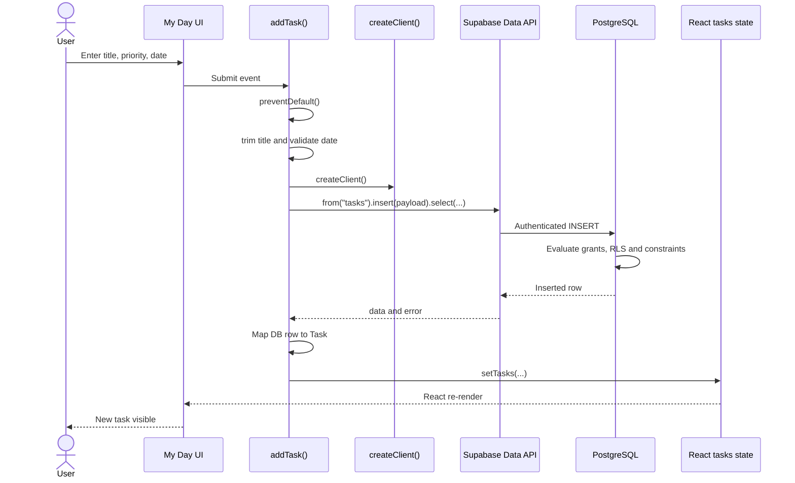

The important security point is that the UI's validation and `user_id` payload are not enough by themselves. The database has to enforce the authenticated user's permission.

## 28.2 Example: user checks a habit

1. User clicks a habit.
2. `toggleHabit(id)` locates the habit.
3. It calculates the next completion value.
4. It builds the date key for today.
5. It calls `habit_checkins.upsert(...)`.
6. The conflict target makes the user/habit/date combination the unique logical entry.
7. If successful, local state changes.
8. Weekly totals and streak history are updated.

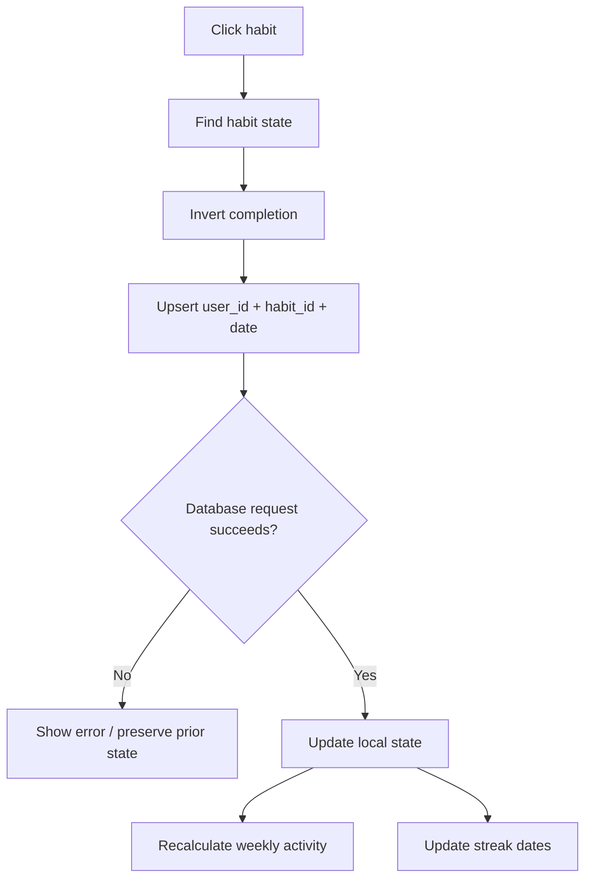

## 28.3 Example: user applies a weekly Fitness routine

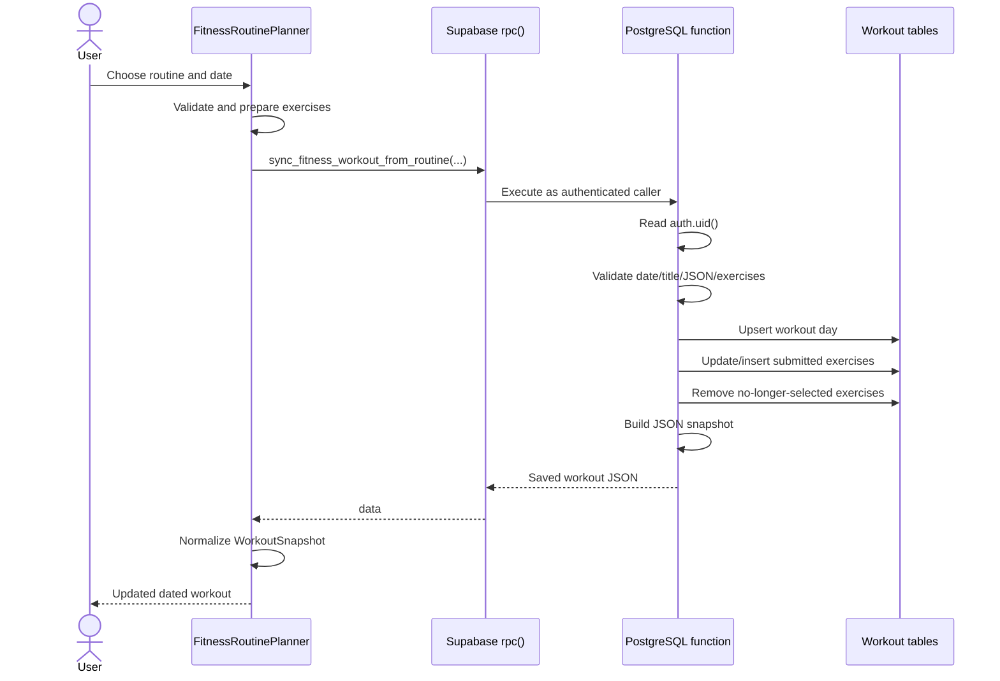

The database function validates the entire exercise payload before changing the dated workout rows. This reduces the risk of saving only part of a routine.

## 28.4 Example: dashboard Practice Time

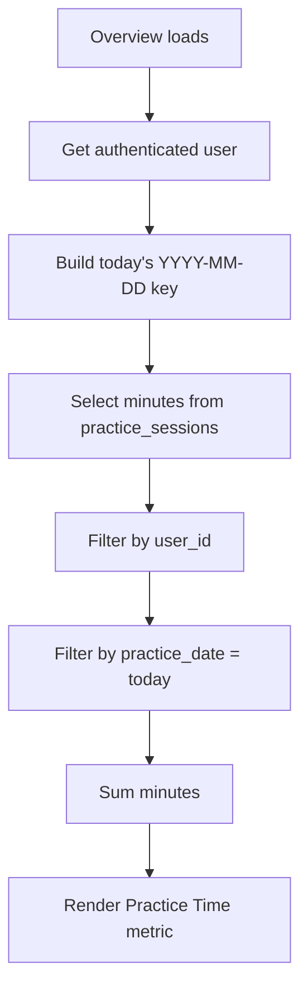

The Dashboard does not calculate this number from tasks or from a hard-coded value. It reads the `practice_sessions.minutes` records.

---

# 29. How to read the code in the best order

If I need to explain LifeOS to a faculty member or debug a feature, this is a useful reading sequence.

| Order | File | Why read it |
|---:|---|---|
| 1 | `package.json` | Understand the tools and scripts |
| 2 | `src/app/layout.tsx` | Understand the root document and provider |
| 3 | `src/app/page.tsx` | Understand the public project introduction |
| 4 | `src/app/login/auth-form.tsx` | Understand sign-up and sign-in |
| 5 | `src/proxy.ts` | Understand protected-route request handling |
| 6 | `src/lib/supabase/proxy.ts` | Understand session claims and redirects |
| 7 | `src/lib/supabase/client.ts` | Understand how browser code connects to Supabase |
| 8 | `src/app/lifeos-app.tsx` | Understand the main app, Overview and My Day |
| 9 | `src/features/trackers/tracker-workspace.tsx` | Understand a custom tracker CRUD workflow |
| 10 | `src/features/goals/goals-workspace.tsx` | Understand parent/child records and milestone progress |
| 11 | `src/features/academics/academics-workspace.tsx` | Understand calculations and multi-table data |
| 12 | `src/features/fitness/fitness-workspace.tsx` | Understand dated workouts and exercises |
| 13 | `src/features/fitness/fitness-routine-planner.tsx` | Understand reusable templates and RPC |
| 14 | `src/features/personal-growth/personal-growth-workspace.tsx` | Understand practice sessions and learning resources |
| 15 | `src/features/analytics/analytics-workspace.tsx` | Understand cross-feature aggregation |
| 16 | `supabase/migrations/*.sql` | Understand database evolution and security changes |

---

# 30. Database facts I should be able to defend in a viva

| Question | Evidence to show |
|---|---|
| Where does a task get saved? | `src/app/lifeos-app.tsx`, `addTask`, `tasks` table |
| Which field identifies the owner? | `user_id` in app queries and RLS policy |
| How are today's habit check-ins stored? | `habit_checkins` upsert in `toggleHabit` |
| Why is the check-in upsert idempotent for one date? | Conflict target `(user_id,habit_id,checkin_date)` |
| Where is practice duration stored? | `practice_sessions.minutes` |
| How does a goal have multiple milestones? | `goal_milestones.goal_id` used by the Goals component |
| How are course marks connected? | `academic_assessments.course_id` used by Academic loading/mapping |
| Where does the grade scale live? | `academic_grading_bands` |
| How are weekly routines connected to exercises? | `workout_routine_exercises` with composite `(user_id,routine_id)` foreign key |
| What function applies a Fitness routine? | `sync_fitness_workout_from_routine` |
| What protects a new Fitness table? | Table grants plus RLS owner policy |
| What protects task system-managed fields? | Task column-level grants and completion timestamp function |
| Does the ZIP contain every base table's DDL? | No; only selected migrations are included |

The best way to answer a technical question is to open the relevant source file and show the actual code, not only describe the feature from memory.

---

# 31. What I still need to finish the database schema to 100%

The source archive has enough information to explain the application and the SQL migrations it includes. It does **not** contain the full original schema for every LifeOS table.

To produce a complete ERD and exact schema reference, I need the output of the SQL export queries in Section 26.7. In particular:

- All columns and data types.
- Primary and foreign keys.
- Unique and CHECK constraints.
- Indexes.
- RLS enabled/forced state.
- Every policy's `USING` and `WITH CHECK`.
- Table and column grants.
- Triggers and their attached functions.
- PostgreSQL function definitions and security modes.
- Storage buckets and Storage policies.

Once those actual results are available, this README can replace the application-level relationship map with the exact live schema. Until then, the database details above remain carefully separated into verified migration DDL, application-observed fields and historical audit observations.
